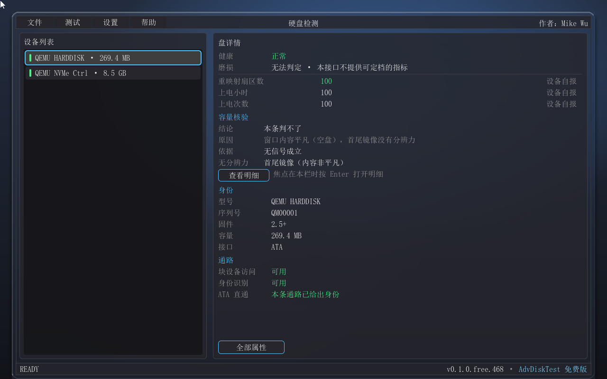
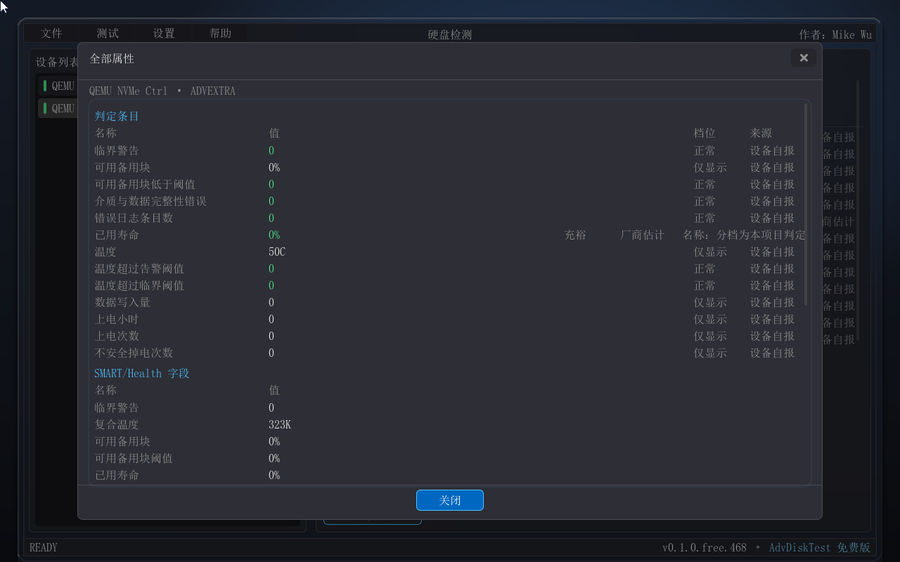
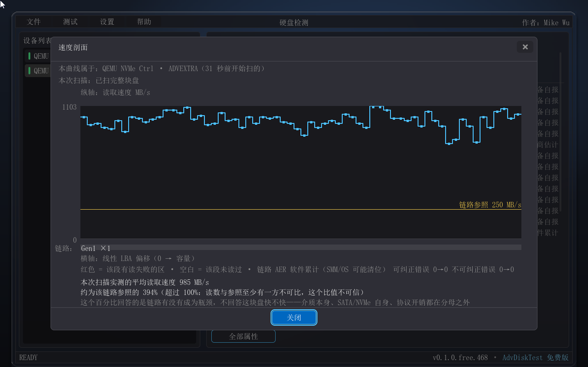
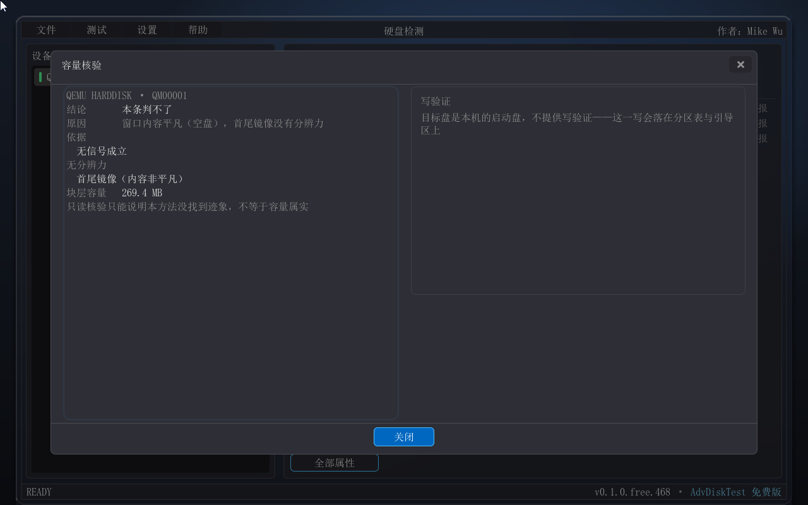
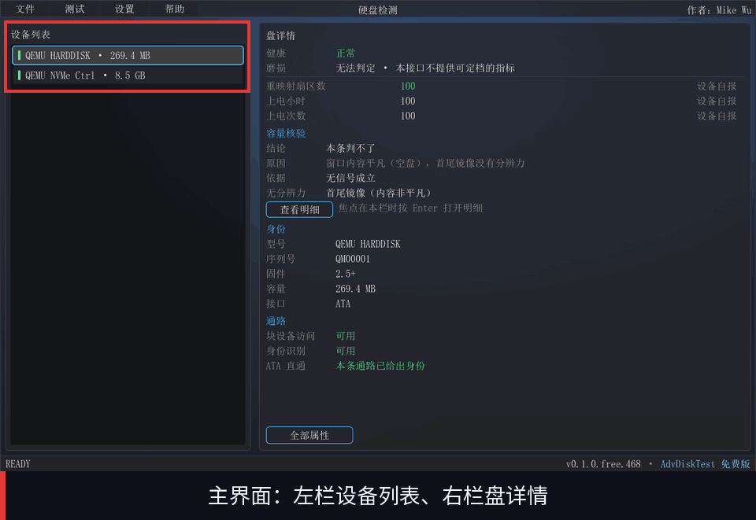

# AdvDiskTest — 硬盘检测工具（二进制发布包）

> [English version below](#english) ｜ [English README](#english)

AdvDiskTest 是运行在 **UEFI 环境**下的原生图形化硬盘检测工具：不引导操作系统、不加载驱动栈，而是作为一份 UEFI 应用直接在固件的 UEFI Shell 里跑起来（也可以走免 Shell 的可直启 ISO，中间不经过 Shell）。系统已经起不来、盘上的数据读不出来、机器里甚至根本没装系统——这些恰恰是"盘出了问题"时最常见的处境，也正是这类工具存在的理由。检测对象是硬盘与固态硬盘本身，以及它连接的那条链路：盘是这条链路上的一个传感器，要一起看的还有插槽、转接卡、线缆与背板——一块 Gen4 x4 的固态盘插在 Gen3 的插槽上，盘本身毫无毛病，性能天花板却已经被砍掉一半，这种情形必须与"盘坏了"分开报，否则用户会拿一块好盘去换货。

**身份与健康**：NVMe（Identify）与 ATA（IDENTIFY DEVICE）两条通路取型号、序列号、固件版本与容量；SMART 读数把「**健康**」（现在有没有出问题）与「**磨损**」（寿命还剩多少）拆成两条独立的轴，各给档位（正常 / 注意 / 故障 / 无法判定；充裕 / 接近终点 / 已耗尽 / 无法判定），并把每一条依据与它的来源（设备自报 / 厂商估计 / 软件累计 / 未取到）摊开在屏幕上。**链路健康**：以"盘能力 / 槽能力 / 实况"三方对照判定 PCIe 链路有没有被降级——正常 / 平台所限 / 降级 / 降级（确定）/ 未训练 / 测不到，六档分开报；AER 错误计数按"软件累计"标注口径（固件或操作系统清过位的错误看不到）。**只读表面扫描**：按区域顺序读完整块盘、测出每一段区域的读取速度，对照这条链路的理论上限画成逐区域速度剖面——整个过程不写一个字节，跑在正在使用的盘上也安全。**设备自检**：NVMe Device Self-test 与 ATA SMART 离线自检由盘自己执行，短自检与扩展自检两档，不破坏盘上数据。另有错误日志（可靠性证据的主体）、容量核验（含扩容盘识别：只读档 + 可选的有界写验证档）与单文件 HTML 报告导出。

> 一块盘的健康结论，不该是一个看起来很确定的百分比——拿不准的地方要说拿不准，并且让人看得见这个结论的依据有多硬。

*（本文档的界面截图与演示动图摄于上一个构建——画面水印为 `v0.1.0.free.468`；本次发布为 `0.1.0.469`，两次构建之间没有功能改动。）*

- **版本**：0.1.0（Build 469；免费版）——构建号每次构建递增，发布时以实际产物为准
- **发布**：tag **`AdvDiskTest-v0.1.0.469`**（2026-10-14、Build 469、免费版）——**首个入列版**
- **作者**：Mike Wu
- **许可**：个人用户免费使用；商业用途需授权（商业路径 = AdvDiskTest 专业版，请联系作者）——见[套件根 README 的许可节](../README.md)
- **产品手册**：[免费版用户手册（MD）](docs/manual/advdisktest-free-user-guide.md) ｜ [Word 版](docs/manual/advdisktest-free-user-guide.docx) ｜ [功能演示 GIF](docs/manual/advdisktest-feature-tour.gif)（演示帧摄于上一个构建） ｜ [ISO 用法说明](docs/manual/iso-boot-readme.txt) —— 含全部功能截图与使用说明

## 包内容

| 文件 | 说明 |
|---|---|
| `binaries/advdisktest-free.efi` | 应用本体（UEFI x64 应用，约 2.8 MB）——**免费版**，个人用户免费使用、无需授权文件 |
| `iso/AdvDiskTest-boot-0.1.0.469+20261013_221722.iso` | **可启动光盘镜像**（免 UEFI Shell 直启 Live-CD，El Torito + 内嵌 ESP，约 8.6 MB；文件名带版本号 + 时间戳——改版留档）。用法与注意事项见 [ISO 用法说明](docs/manual/iso-boot-readme.txt) |
| `docs/manual/` | 产品手册（免费版用户手册，MD + Word 两种渲染）+ 功能截图与演示动图 + ISO 用法说明 |
| `AdvDiskTest-0.1.0.469+20261013_221722.zip` | 便捷包（程序 + ISO + 手册 + 截图与动图——与 Release 资产同内容） |

专业版（无人值守与批量检测、老化与耐久循环、判定引擎（阈值可配）、结构化归档与报告签名、完整 PCIe 拓扑树与 AER 详情）不随本目录公开发布：**Pro 专有——请联系作者获取授权**，获授权后按商务渠道交付。免费版里带（Pro）标记的菜单项即上述专业版功能，灰显并锁定，选中时给出同一句提示。

## 快速上手

1. **UEFI Shell 方式**：把 `binaries/advdisktest-free.efi` 复制到 UEFI Shell 所在盘（通常 fs0:），在提示符下输入文件名并回车；也可写进 `startup.nsh` 开机自启。
2. **免 Shell 方式**：把 `iso/AdvDiskTest-boot-0.1.0.469+20261013_221722.iso` 刻盘、挂服务器 BMC 虚拟光驱，或按 [ISO 用法说明](docs/manual/iso-boot-readme.txt) 写入 U 盘，开机从该设备启动——直接进主界面。
3. **先关 Secure Boot**：本程序没有微软签名，开着 Secure Boot 的机器不会放行（见「平台与运行要求」）。
4. 主界面左栏是设备列表（型号 · 容量），右栏是选中盘的详情与结论；「全部属性」把每条判定的依据与来源摊开。
5. 「测试」菜单里跑一次全盘只读表面扫描，看逐区域速度剖面与链路参照线；也可以发起一次设备自检，让盘自己压一压（不毁数据）。
6. 「报告导出」把这一轮的结论落成单文件 HTML，文件名形如 `ADVDSK_<序列号>_<日期-时刻>.html`，写在启动卷根目录。

## 功能示例

## 平台与运行要求

| 项目 | 要求 |
|---|---|
| 平台 | x64（x86-64）UEFI 固件，无操作系统要求；**不支持 Legacy / CSM 启动** |
| Secure Boot | **必须先关闭**——本程序未做代码签名，开着 Secure Boot 的固件不会放行 |
| 启动形态 | 可直启 ISO（`iso/AdvDiskTest-boot-0.1.0.469+20261013_221722.iso`——刻盘 / 挂 BMC 虚拟光驱 / 写入 U 盘即用，不需要先有 UEFI Shell）或 UEFI Shell 手动 / 自动运行（`binaries/advdisktest-free.efi`，单文件、无外部依赖） |
| 屏幕 | 图形控制台（UEFI GOP）：1280×800 或更高——启动时自动向固件索取满足 1280×800 的显示模式，取不到则按当前分辨率运行 |
| 输入 | 鼠标与键盘都能操作（Tab 焦点环 / 方向键 / Esc 逐层返回，全流程可以不用鼠标） |
| 介质 | 报告导出需要一个**可写的卷**；从只读介质（如光盘）启动时程序照常运行、界面与退出都不受影响，但报告导不出来——程序会在导出屏上写清原因（详见 [ISO 用法说明](docs/manual/iso-boot-readme.txt)）；外观设置同样只当场生效、不落盘 |

两点需要在使用前知道：若磁盘在固件里被 RST / RAID 模式接管，应用里会完全看不到该盘——界面会给出说明与处置指引（在 BIOS 中改为 AHCI 后重试），而不是留下一张空白列表；本版 ISO 已实测的启动链路与尚未实测的启动方式，逐条列在 [ISO 用法说明](docs/manual/iso-boot-readme.txt) 里。

## 变更记录

- **2026-10-14 · AdvDiskTest-v0.1.0.469**：**AdvDiskTest 二进制发布首版（0.1.0 Build 469）**——设备识别（NVMe Identify / ATA IDENTIFY）、健康与磨损双轴判定（档位 + 依据 + 来源，含"无法判定"）、PCIe 链路降级判定（盘能力 / 槽能力 / 实况三方对照，六档）、全盘只读表面扫描与逐区域速度剖面（含链路参照线）、设备自检（NVMe Device Self-test / ATA SMART 离线自检，短与扩展两档，不破坏数据）、错误日志（NVMe 错误日志页 / ATA 错误日志，按成因归类）、容量核验（含扩容盘识别：只读档 + 可选的有界写验证档）、单文件 HTML 报告导出；首发即带免 Shell 可直启 ISO（El Torito + 内嵌 ESP）。专业版功能（无人值守与批量、老化与耐久循环、判定引擎、结构化归档与签名、完整 PCIe 拓扑树与 AER 详情）为 **Pro 专有——请联系作者获取授权**。

## 姊妹工具

本套件其它成员：pcDig（整机硬件诊断）、BootDoctor（启动诊断修复）、AdvMemTest（内存压力测试）、UefiEraser（磁盘数据粉碎）、uwinunlocker（离线重置 Windows 本地账户密码）。运行环境与 GUI 底座同为 LVGL 的 UEFI 移植。

## 许可

本工具：**个人用户免费使用；商业用途（营利性部署 / 分发 / 预装）需提前联系作者书面授权**——商业路径 = AdvDiskTest 专业版授权，请联系作者。本目录未附 LICENSE 文件，适用[套件根 README](../README.md) 的许可节条款。第三方组件：图形库 LVGL 遵循其自身许可（MIT）。

---

## English

# AdvDiskTest — Disk Diagnostics Tool (Binary Release Package)

AdvDiskTest is a native GUI disk and SSD diagnostics tool for **UEFI**: no operating system involved — it runs as a UEFI application in the firmware's UEFI Shell, or boots straight from a shell-free Live-CD ISO. It is built for the moments when a machine no longer boots, and it examines both the drive and the link it is attached to: identify the drive (NVMe Identify / ATA IDENTIFY), grade **health** and **wear** on two independent axes — each verdict with its evidence and the provenance of every value, and an explicit "undecidable" instead of a confident-looking percentage — judge whether the **PCIe link** has been degraded (drive capability vs slot capability vs negotiated state, six verdicts; "limited by the platform" is reported separately from a real degradation), run a **read-only full-surface scan** with a per-region speed profile referenced to the link's theoretical ceiling (not a byte is written), run **device self-tests** that do not destroy data (NVMe Device Self-test / ATA SMART offline), read the drive's **error logs**, verify **capacity** (fake-capacity / over-provisioned drives — a read-only tier plus an optional bounded-write tier) and export a single-file **HTML report**. Simplified-Chinese UI, mouse and keyboard both work.

- Version 0.1.0 (Build 469, 2026-10-14) ｜ Author: Mike Wu. Screenshots and the demo GIF were captured from the previous build (watermark `v0.1.0.free.468`) — the same functionality, rebuilt only.
- **Release**: tag `AdvDiskTest-v0.1.0.469` (2026-10-14) — the first binary release of AdvDiskTest.
- **Downloads**: `binaries/advdisktest-free.efi` (~2.8 MB UEFI application, Free edition, free for personal use) and `iso/AdvDiskTest-boot-0.1.0.469+20261013_221722.iso` (~8.6 MB shell-free bootable Live-CD, El Torito + embedded ESP); the convenience bundle `AdvDiskTest-0.1.0.469+20261013_221722.zip`.
- **Docs**: [user manual (MD)](docs/manual/advdisktest-free-user-guide.md) ｜ [Word](docs/manual/advdisktest-free-user-guide.docx) ｜ [feature GIF](docs/manual/advdisktest-feature-tour.gif) (demo frames from the previous build) ｜ [ISO usage notes](docs/manual/iso-boot-readme.txt)
- **License**: free for personal use; commercial use requires a license — the commercial path is the AdvDiskTest Pro edition; please contact the author. See the License section of the [suite root README](../README.md).

Boot the ISO as a virtual CD, or write it to a USB stick in image mode and boot from it — no UEFI Shell needed; **disable Secure Boot first** (the image is unsigned). The routes already measured for this build, and the ones that are not measured yet, are listed one by one in the [ISO usage notes](docs/manual/iso-boot-readme.txt). The Pro edition (unattended / batch operation, aging loops, a rule engine, structured archiving and signing, a full PCIe topology tree with AER detail) is delivered through the business channel only.

## License

Free for personal use; commercial use (profit-oriented deployment / redistribution / pre-installation) requires written authorization from the author — the commercial path is the AdvDiskTest Pro edition; please contact the author. This directory ships no LICENSE file; the License section of the [suite root README](../README.md) governs. Third-party: the LVGL graphics library retains its own license (MIT).
