# advdisktest

产品手册・免费版

UEFI 原生硬盘检测工具

版本：0.1.0　构建：469

作者：Mike Wu

日期：2026-10-14

本文档的界面截图与演示动图摄于上一个构建——画面水印为 v0.1.0.free.468；本次发布为 0.1.0.469，两次构建之间没有功能改动。

本手册随版本更新。

# 目录

1.　这是什么

2.　启动与操作

3.　设备识别

4.　健康与判定

5.　表面扫描与速度剖面

6.　链路健康

7.　设备自检

8.　错误日志

9.　容量核验

10.　报告导出

11.　界面一览

12.　附录 A：口径与限制

13.　附录 B：术语表

# 1.　这是什么

advdisktest 是一款运行在 UEFI 环境下的原生图形化硬盘检测工具。它不挂在任何操作系统下面：不引导一个精简 Linux，不加载驱动栈，而是作为一份 UEFI 应用直接在固件的 UEFI Shell 里跑起来，用鼠标和键盘操作，界面全中文，观感对齐 Windows 11。这意味着哪怕系统已经起不来、盘上的数据读不出来、甚至机器里根本没有装系统，它照样能运行——而这恰恰是“盘出了问题”时最常见的处境。

它的检测对象是硬盘与固态硬盘本身，以及硬盘所连接的那条链路。对外我们说这是“硬盘检测”，而真正要回答的问题更大一些：盘是这条链路上的一个传感器，需要一起看的还有插槽、转接卡、线缆与背板。一块 Gen4 x4 的固态盘插在 Gen3 的插槽上，盘本身毫无毛病，但它的性能天花板已经被砍掉一半——这种情形必须在界面上与“盘坏了”区分开，否则用户会拿一块好盘去换货。

围绕这个目标，工具里有三条贯穿始终的取舍。结论必须给“档位”而且必须带上依据：屏幕说“健康 正常”的时候，同一屏上能看见这个结论依据了哪几项、每一项是谁说的；而拿不准的时候，界面上写的就是“无法判定”，不是一个看起来精确的百分比。性能只回答可回答的问题：工具给的是“这条链路有没有成为瓶颈”，而不是一个可以拿去跟别的盘比较的分数。凡涉及写盘的动作，安全全部落在确认设计上——确认框里点名目标盘的型号与序列号，要求手输确认信息，启动盘不可选，执行中可中断且如实告知中断后的后果。

图 1　主界面：左栏是设备列表，右栏是选中盘的详情

# 2.　启动与操作

advdisktest 是一份 UEFI 应用，不提供安装程序，也不需要安装。使用它只需要一只 U 盘和一次重启。

## 启动盘的制作

把 U 盘格式化为 FAT（FAT32 即可），将 advdisktest-free.efi 拷到根目录。在目标机器上先关闭 Secure Boot：本工具未做代码签名，Secure Boot 处于开启状态时，固件会拒绝运行未签名的引导器，工具根本起不来——这一步做不了的话，后面的一切都无从谈起。

然后在固件的启动菜单里从该 U 盘启动，进入 UEFI Shell，在提示符下输入 advdisktest-free.efi 并回车。许多主板的固件里带有一个 UEFI Shell，通常会出现在启动菜单里；若手边这台没有，可以把一份 Shell.efi 一并放到 U 盘上，从它引导。想让整个过程自动完成，就把 UEFI Shell 放到 U 盘的 \EFI\BOOT\BOOTX64.EFI，并在根目录放一个 startup.nsh，内容一行 advdisktest-free.efi——此后从这只 U 盘引导即可直接进入应用。

## 鼠标与键盘

两套输入都完整可用，不需要二者兼有。鼠标可以直接点列表、点按钮、点菜单。键盘这边，Tab 在主界面的五个焦点区之间循环：设备列表、盘详情、「全部属性」按钮、底部的平台信息条、菜单栏。焦点落在哪一项，哪一项就高亮；失焦的项暗显，所以任何时候都能一眼看出“现在回车会作用到哪里”。

在设备列表里用上下键换盘，右栏的详情随之刷新；Enter 打开当前项的明细或激活当前按钮。菜单栏里用左右键在四个菜单（文件、测试、设置、帮助）之间移动，下键展开下拉，上下键选项，Enter 执行，Esc 逐层返回；下拉展开时 Tab 锁在项内循环，不会出现“焦点跑出下拉而菜单还开着”的浮层。对话框打开后，Tab 在框内控件之间循环。

Esc 的层级是固定的：先关消息框，再收下拉菜单，再关对话框，然后是扫描中的暂停与继续，最后才是空闲时的退出确认。扫描的停止只走菜单——运行中按一下 Esc 就停会让一整轮工作白做。

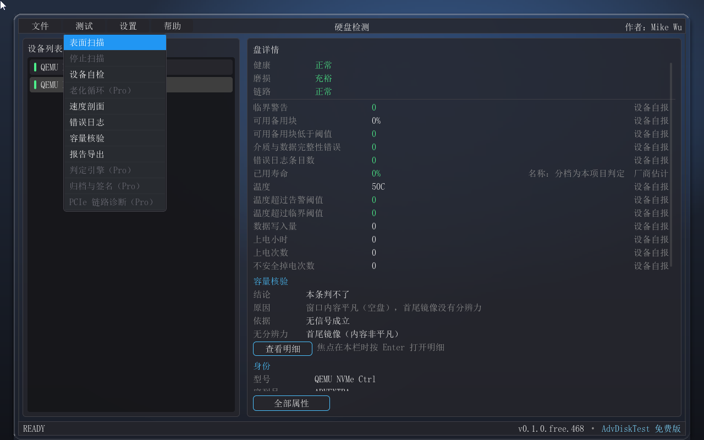

图 2　菜单全程键盘可达：方向键选项、Enter 执行、Esc 逐层返回

# 3.　设备识别

左栏的设备列表把每一块盘列成“型号 · 容量”两段，选中哪一块，右栏的详情面板就换成哪一块的内容。列表不写盘符：盘符是本次启动的临时映射，同一块盘换一台机器、换一次启动就可能变，而型号与序列号不会。

详情面板分段给出身份、链路、通路与异常四类信息。身份段列出型号、序列号、固件版本、容量与接口类别，这几项是后面一切判定的主语——做任何写操作之前，用户都能在这里确认自己选中的到底是哪一块盘。

通路段回答的是“这台机器能不能跟这块盘说上话”，它有三种状态：可用、不可用，以及不适用。不适用的行根本不出现——一块 NVMe 盘不会显示“ATA 直通”这一行，因为那条通路在这块盘上不存在；把它显示成一个红色的“不可用”，就是对一块可能完全健康的盘凭空定罪。而“可用/不可用”的主语也必须是这条通路本身：屏幕写“本条通路未给出身份”的意思是这条直通路径在探测时没有答话，而不是“这块盘没有身份”——身份也可能由另一条路径取到，两句话不能互换。

异常段只在真有问题、或者真取不到的时候才出现，而且措辞一律把“测不到”与“有问题”分开：本机读不到 PCIe 链路能力时，屏上说“本机读不到 PCIe 链路能力”，并补一句“测不到不等于有问题，不代表链路异常”——主语是本机，不是设备。

如果一台机器上一块盘都没有出现，界面不留下一个空白列表，而是给出三行说明：未检测到任何磁盘 / 若本机开启了 RST / RAID 模式，磁盘会完全不可见 / → 请在 BIOS 中改为 AHCI 后重试。这是很常见的真实处境，而一块空白会让用户以为机器里没有装盘。

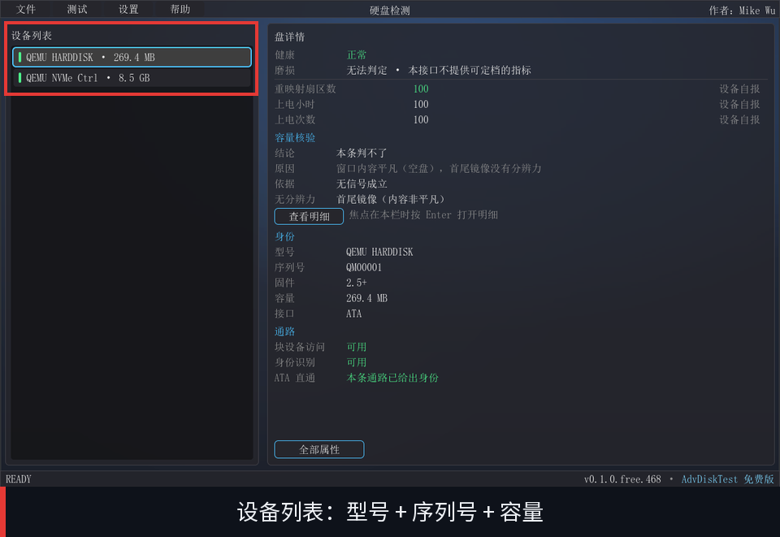

图 3　设备列表：型号 + 序列号 + 容量；右栏同时给出通路三态

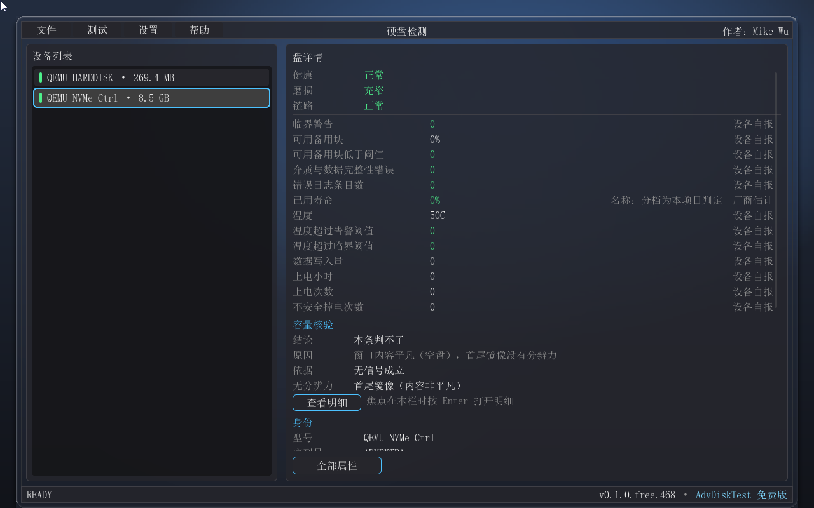

图 4　切换设备：右栏详情随之切换

# 4.　健康与判定

健康与磨损是两条独立的轴。健康轴看的是“这块盘现在有没有出问题”（正常 / 注意 / 故障），磨损轴看的是“它的寿命还剩多少”（充裕 / 接近终点 / 已耗尽）。两条轴各有一个第四档“无法判定”，它的含义是“本接口不提供可定档的指标”——既不是“没问题”，也不是“有问题”，而是我们拿不到能定档的东西。

结论那一行上没有百分比，这是刻意的取舍。一个“健康度 92%”读起来像一个可以信赖的分数，而它实际的含义往往只是厂商写在某个计数器里的磨损里程：它既不预测剩余寿命，也不区分“用了很多但状态良好”与“用了不多但已经在出错”。给档位、并把依据摊开摆在旁边，是本工具与既有工具最明显的分野。

依据摊开的形式是「全部属性」对话框：上半是判定条目，每一项都有名称、值、档位、来源四列；下半是原始数据，ATA 盘的原始属性表逐槽搬运，NVMe 盘则把 SMART/Health 的字段逐项列出，供查证用。每一条依据都带着它的来源：设备自报（设备自己报出来的数）、厂商估计（数值由厂商给出，分档由本工具判定）、软件累计（本工具在一次运行期间累加出来的数）、未取到（这一项这次没拿到）。来源只说这个值有多可信，不用颜色——颜色已经被严重度占用了，同一个通道承载两种含义会让人分不清“不确定”与“警告”。

依据不完整时，结论那一行会带上“依据不完整：缺 N 项”，把结论建立在几项之上说清楚。反过来，若某一项属性是这块盘压根不报告的（当代固态盘普遍不再报告一些传统属性），条目上会标“本盘未报告”——这是一句关于设备的事实，不是我们的缺口，因此它不计缺口。

图 5　全部属性：上半是判定条目（含档位与来源两列），下半是原始字段

# 5.　表面扫描与速度剖面

表面扫描是全盘只读的：它按区域顺序读取整块盘，测出每一段区域的读取速度，并记录读失败的区域，整个过程不写一个字节。这是一个可以放心跑在正在使用的盘上的动作。

它把容量切成大小自适应的区域（大盘按 1 GiB 一段，容量小的盘按下限收紧），相邻区域聚合成图上的一列，取该列内实测的读取速度。横轴是按容量比例铺开的 LBA 偏移，纵轴是读取速度。这样得到的一条曲线，看的是这块盘在不同位置上的速度表现。

曲线上的红色与空白是两件完全不同的事，这一点必须读准：红色表示该段有读失败的区，空白表示该段未读过（还没扫到这里，或者这一轮没扫完）。换句话说，“没扫到”与“扫到了但慢”在图上完全不是一个样子——这条区分正是这张图存在的意义之一。

图上另有一条横向的参照线，标着“链路参照”。它不是这块盘的性能预期，而是这条链路在理论上能提供多少带宽，由链路当前的速率与宽度换算而来（Gen1 x1 约 250 MB/s，Gen4 x4 约 7.9 GB/s）。参照线的用处是回答一个可回答的问题：读出来的速度离这条链路的理论上限还有多远。

读数行给出的百分比必须连着它的限定句一起读：这个百分比回答的是链路有没有成为瓶颈，不回答这块盘快不快——介质本身、盘自己的控制器、协议开销都在分母之外。同一个 20%，既可能是链路在拖后腿，也可能这块盘本来只到那儿。如果比值超过 100%，工具不会把它夹到 100，而是当面说明“超过 100%：读数与参照至少有一方不可比，这个比值不可信”——夹住它是用一个看着合理的结论去盖住两个不可比的数。

扫描没跑完时，平均值那一格会带上口径：MB/s（仅已扫到的部分，不是全盘平均）。覆盖行也如实说明“本次扫描：未扫完”并给出理由（已停止，或者扫描途中该盘已不可用）；只有真正跑完才写“本次扫描：已扫完整块盘”。

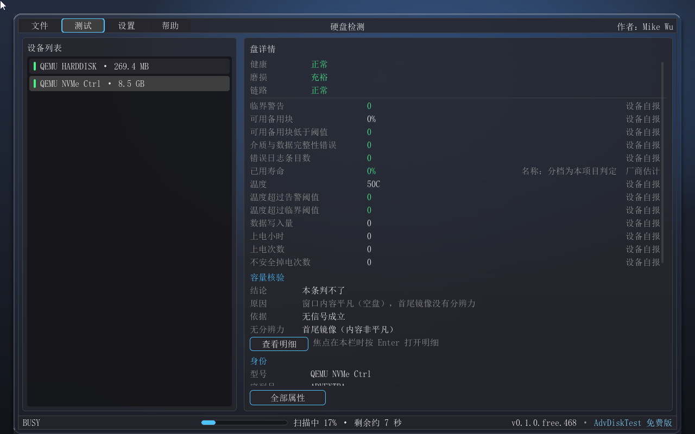

图 6　扫描进行中：底栏给出进度与剩余时间

图 7　速度剖面：逐区读速度曲线、链路参照线与实测平均值

下面这一对图是同一段动图：先给它的封面（第 1 帧加标注与说明条），再放动图本身。在不会播放动图的阅读器里（例如 Word），下面那张图在屏幕上一直是静止的第 1 帧——封面那张画的是同一帧，两张看起来相近是正常的，不是重复排版。

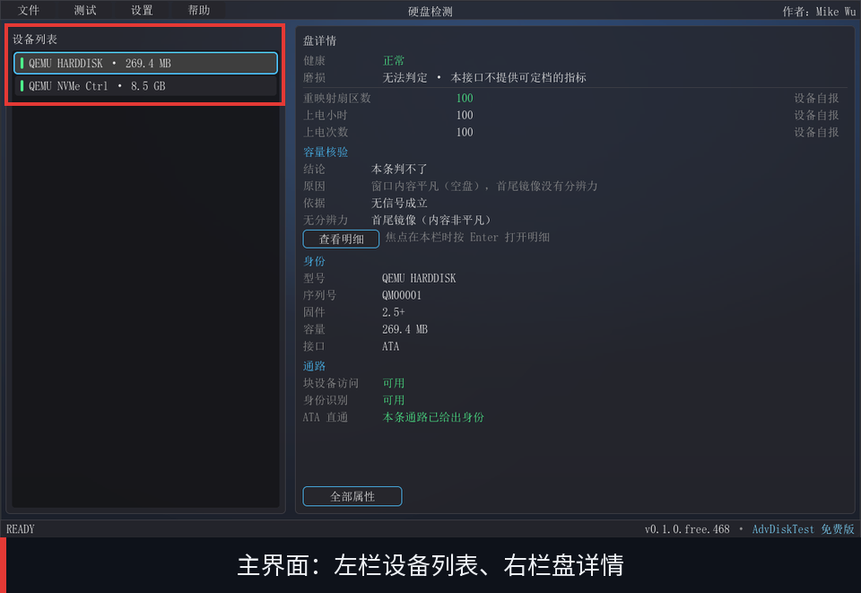

图 8　动图①的封面：第 1 帧（带标注与说明条）

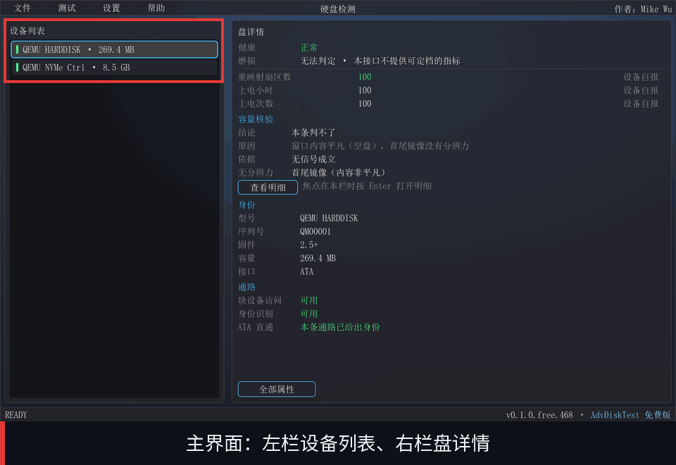

图 9　动图①（扫描全程）：不会播放动图的阅读器里显示第 1 帧

# 6.　链路健康

链路健康回答的是“这块盘跑在它应有的速率与宽度上了吗”。工具读出三个数并排陈列：盘能力（盘自己声明支持的上限）、槽能力（上游端口提供的能力）、实况（链路当前协商出来的状态），每个数都标着它的来源。Gen4 x4 的盘插在 Gen4 x4 的插槽上、实况也是 Gen4 x4，链路就没有问题；盘与槽都是 Gen4 x4 而实况只有 Gen3 x4，问题既不在盘上也不在槽上，而在两者之间的连接上。

判定分档，不混成一句“降级”：正常、平台所限、降级、降级（确定）、未训练、测不到。“平台所限”说的是槽能力低于盘能力、而盘本身没有异常——它落在中性色上，不是一个故障结论。“降级（确定）”要两个前提都成立才说：多次采样的结果一致，而且槽能力取到了；少了后一个前提，插在弱槽里的好盘天生就会被误判。样本之间不一致时，屏幕说的是“链路状态不稳定（可能处于低功耗态或重训练中）”，而不是给出一个瞬时读数下的结论。上游能力取不到时，界面直说“上游能力未取到，无法区分真降级与平台所限”——分不清就说分不清，这是这块工具反复守的一条线。

判定不会拿一次快照下结论：低功耗态与链路重训练期间的读数会瞬时偏低，所以工具取稳定态、多次采样之后再判。

链路上的错误计数有一层必须连同它一起读的限定：AER 错误计数是软件累计（SMM/OS 可能清位）。PCIe 的 AER 寄存器组里没有硬件计数器，status 位只有“读 + 写 1 清位”的语义，所以工具看到的是自己观察期间 0 到 1 的翻转次数。它单调只增，但同一事件若未被清位就重复发生只会计一次，而固件或操作系统清过位的事件在两次观察的间隙里看不到。因此它不能被读成“自开机以来的总错误数”。界面上凡出现这两个计数，都带着这层限定词。

还有一条噪声抑制：若同一个可纠正错误的形态在链路的各个端点上重复出现，工具判为电源管理噪声，不计为错误。这类噪声在正常机器上很常见，把它计成故障会让判定整体失去意义。

图 10　速度剖面下沿的链路状态带：速率 × 宽度与 AER 计数（带“软件累计”限定）

# 7.　设备自检

设备自检是硬盘自己跑的自检：工具把任务递交给盘，再由盘自己执行，然后读回结果，整个过程不破坏盘上数据。这是“想压一压这块盘、又不想毁掉数据”时的正路。NVMe 盘走 Device Self-test，ATA / SATA 盘走 SMART 的离线自检。

自检分两档：short 短自检（分钟量级）与 extended 扩展自检（数十分钟到数小时量级）。发起前有一道确认，说明它不破坏盘上数据，同时说明自检期间不能扫描、也不能切换磁盘。发起之后，这一屏会给出进度与预计剩余时间。

关于中止，这里要说准确：本工具暂不提供中止（该命令存在，但其支持率因固件而异）。中止自检的命令在规范里是有的，只是它在不同固件上的支持程度差异很大，因此工具不提供这个按钮——这句话说的是我们的取舍，不是这块盘做不到。

屏幕上另有一张表列出盘上已有的自检记录，按新到旧排列：结果、类型、完成度、上电小时与失败 LBA。结果一列如实呈现设备报出的状态，包括“未跑完”“被主机中止”“命名空间移除”这类不是“通过/失败”的取值。自检日志为空时，界面说的是“该盘的自检日志是空的——这块盘从未被自检过”，并且补一句：这与“我们这次会话没有发起”是两件事——盘上没有记录，与本次没跑过，是两条不同的信息。

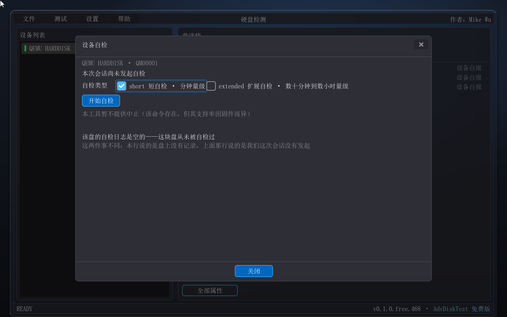

图 11　设备自检：短自检 / 扩展自检与发起确认

# 8.　错误日志

错误日志读的是盘自己记录的错误历史：NVMe 侧读 Error Information Log（日志页 01h），ATA 侧读错误日志。这是可靠性证据的主体——一块盘当下状态可以很好，但如果它的错误日志里有一串可疑记录，那是另一回事。

工具把读到的条目按成因归成四类：介质、链路、主机侧、未识别，并在标题行给出各自的条数。链路类的计数还会并进链路那一行的末尾作为补充，两个数各有各的口径，谁也不包含谁。

两侧的记录顺序与时间口径不同，界面不把它们硬凑成一样。NVMe 按日志页的顺序列出，最近的一条在最前，而这块盘通常不提供错误发生的时间；ATA 侧按盘上的槽位序列出，槽位序不是时间序，有上电小时可用时给出“发生于 N 上电小时”。这两句话都写在表下，因为不说的话，那几条记录读起来就像是按时间排好的。

日志读到了、里面一条都没有的时候，屏幕不会只留一片空白，而是给一句解释：该盘的错误日志里没有条目，这不等于从未出过错——日志只保留最近若干条，写满即覆盖最旧的；NVMe 侧还可能在掉电或控制器复位时被清空。读不到日志时同样如此，说的是本机这一侧的处境，成因也一并说清，不替设备下结论。

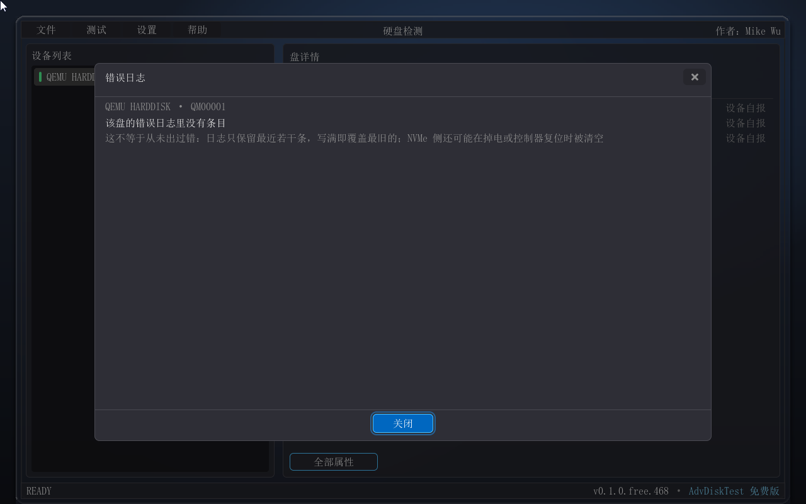

图 12　错误日志：空日志也把话说清楚

# 9.　容量核验

容量核验针对的是一类很具体的坑：标称容量与实际可用容量不符的盘，也就是常说的扩容盘。它有两个档，默认只跑前一个。

只读档不写盘，它比对几个互相独立的信号：首尾镜像（盘的首尾两处内容是否互为镜像）、自称容量内的高位读失败（在盘的标称容量范围之内、靠后的位置是否读不出来）、以及地址空间是否以真实容量为周期重复（超出真实容量的地址回卷到开头）。结论分五档，其中“没有找到问题”这一侧最强也只说到：未发现不实迹象——这不等于容量属实。发现迹象的一侧则可以到“不实（高度嫌疑）”甚至“不实（确定）”。判不了的时候，工具直说“本条判不了”，并把原因与分辨力一并列出：为什么判不了、哪一条信号对这块盘没有分辨力，都是可查的。

有界写验证是第二档，它只动两个位置：LBA 0 起的 1 MiB，以及最后一个扇区。工具在这两处写入一个本次运行新生成的 32 字节模式，读回校验，然后把原内容写回去。这一档能给出比只读更硬的证据——低位窗口里出现验证模式，说明地址空间确实在回卷——代价是它确实会动盘。因此它要求用户在界面上手输这块盘的序列号才能开始，而且启动盘不提供写验证：启动盘正是系统分区表与引导区所在的地方，这一写会落在它们上面。执行中若被中断（含断电），内存里的那份备份就没了、恢复不了，盘上会留下两个被毁的位置；这句话在执行之前就摆在屏上，不在二级框里，也不是按下按钮之后才出现。

图 13　容量核验：只读档的结论与依据；右栏是启动盘的拒绝提示

# 10.　报告导出

导出产出的是一个单文件 HTML：样式内联，不引用任何外部资源，不依赖网络，拷到任何一台有浏览器的机器上都能打开。报告内容包括设备身份、结论、本次运行过的检测项记录、分节事实，以及一节“口径与限制”——把这次报告里哪些数是我们量出来的、哪些是设备自报的、哪些没取到，一并写在报告里，让拿到报告的人不必猜。

文件落在启动卷的根目录，文件名形如 ADVDSK_序列号_日期-时刻.html。这里有一句必须说清的话：本次导出只往启动卷写这一个 HTML 文件，而启动卷可能正是你正在检测的那块盘。这也是长时检测（扫描、自检、容量核验）进行中不允许导出的原因：那一次写会落在正被读的盘上，两件事互相干扰。等它跑完再导出即可。

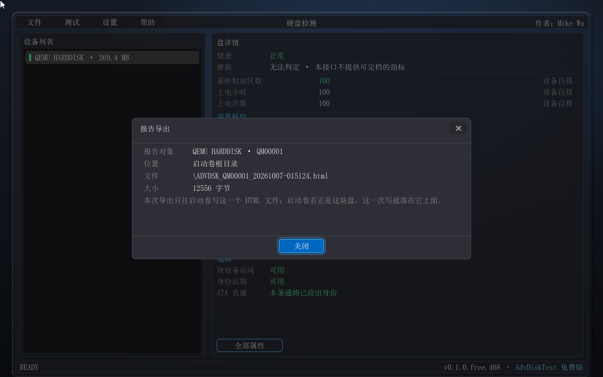

图 14　报告导出：落盘位置、文件名与大小

# 11.　界面一览

下面三段动图分别演示设备列表与详情切换、各检测项的界面，以及 Pro 项在菜单里的样子。它们都按同一组铺排：先给封面（第 1 帧加标注），再放动图本身。在不会播放动图的阅读器里（例如 Word），每一段在屏幕上都是静止的第 1 帧，两张看起来相近是正常的，不是重复排版。

图 15　动图②的封面：设备列表

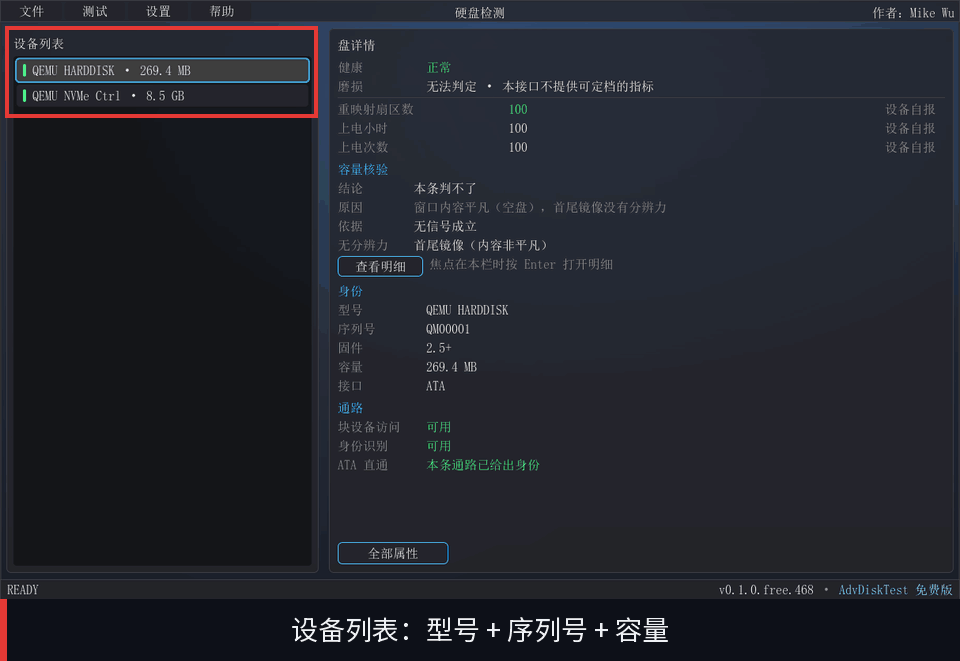

图 16　动图②（设备列表与详情）：不会播放动图的阅读器里显示第 1 帧

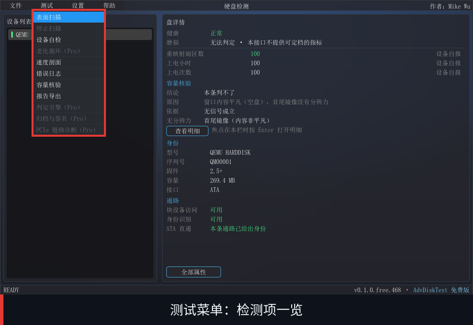

图 17　动图③的封面：测试菜单

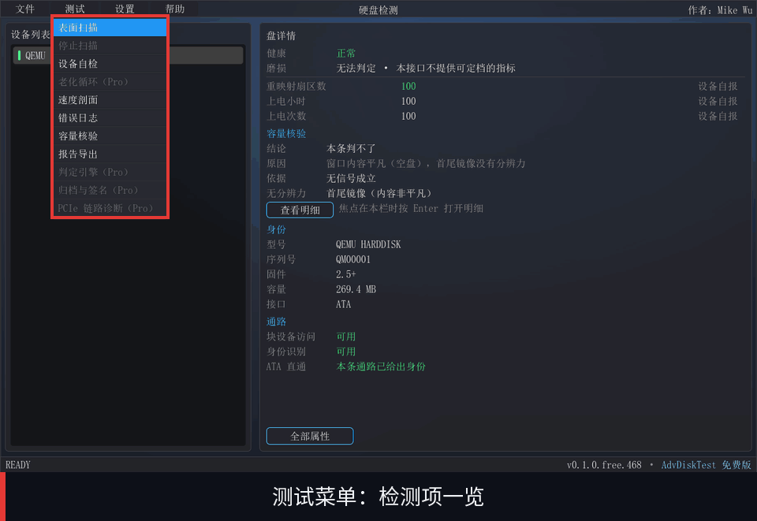

图 18　动图③（各检测项界面）：不会播放动图的阅读器里显示第 1 帧

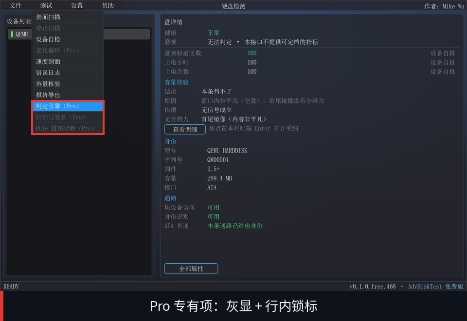

图 19　动图④的封面：菜单里带（Pro）标记的项（灰显 + 行内锁标）

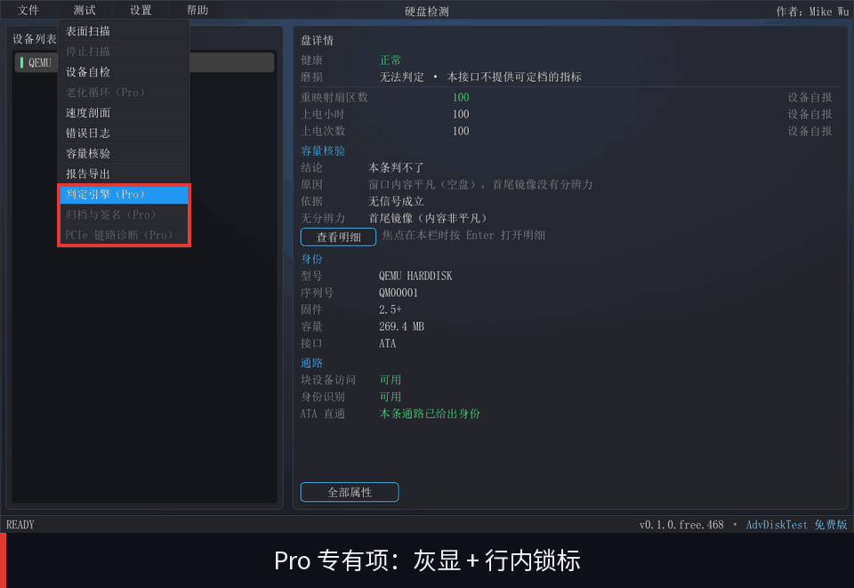

图 20　动图④（Pro 项的菜单形态）：不会播放动图的阅读器里显示第 1 帧

菜单里带（Pro）标记的项目为 Pro 版功能：它们灰显并锁定，选中时提示「Pro 专有——请联系作者获取授权」。

# 12.　附录 A：口径与限制

链路上的速度数字只有在“你要判断的那台机器 + 那块盘”上实测才有产品含义：换一台机器、换一块盘，数字就会变——不同硬件、不同链路上跑出来的 MB/s 不是一回事。本工具的速度读数请以“同一台机器、同一块盘”的前后对比为准，不要拿去做跨机比较，也不要当成绝对性能的判据。

本工具不做的事同样需要说清楚。它不做数据抢救、不做克隆、不搬文件——只诊断，不搬运。它不做擦除、不修分区表、不修扇区：这几件事回答的是“把数据怎么办”，属于处置而不属于检测，而且其中一些会销毁证据。整机诊断（内存、CPU、显卡、显示、风扇）也不在本工具范围内。

还有一条环境限制：Secure Boot 必须关闭，理由见“启动与操作”一节。在管理严格、Secure Boot 被策略锁死的机器上，本工具装不上——这一点绕不开，请在准备使用之前先确认目标机器允许关闭它。

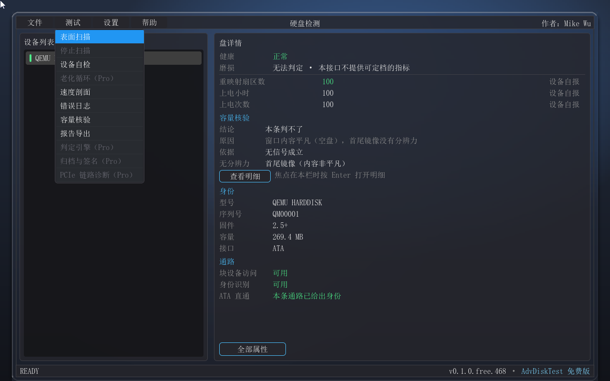

图 21　测试菜单：本工具提供的检测项一览

# 13.　附录 B：术语表

下表解释手册里反复出现的一些词。

| 术语 | 说明 |
| --- | --- |
| 通道 / 直通 | 指对硬盘发送设备级命令的路径（NVMe 直通、ATA 直通）。通路可用与否是一个独立于“这块盘好不好”的事实。 |
| 档位 | 结论的分级（正常 / 注意 / 故障 等）。本工具给档位而不给百分比。 |
| 依据不完整 | 这条结论所依据的条目没有全部取到，缺了几项会写在结论旁边。 |
| 设备自报 | 这个数字是设备自己报出来的，本工具只转述。 |
| 厂商估计 | 数值由固件给出（例如寿命消耗量），而分档是本项目的判定。 |
| 软件累计 | 这个计数是本工具在观察期间自己累加出来的，不是硬件计数器。 |
| 本盘未报告 | 这一项这块盘压根不报告——是关于设备的事实，不是我们的缺口。 |
| 本机读不到 | 这是我们这一侧的处境，不代表设备有问题。 |
| 链路参照 | 由链路的速率与宽度换算出的理论上限，用于回答“这条链路有没有成为瓶颈”。 |
| 扩容盘 | 标称容量大于实际可用容量的盘；超出真实容量的地址会回卷到开头。 |
| 只读档 / 写验证档 | 容量核验的两个强度：前者不写盘，后者写两个位置并恢复。 |
| 免费版 / Pro 版 | 本手册描述的是免费版。菜单里带（Pro）标记的项为 Pro 版功能：Pro 专有——请联系作者获取授权。 |

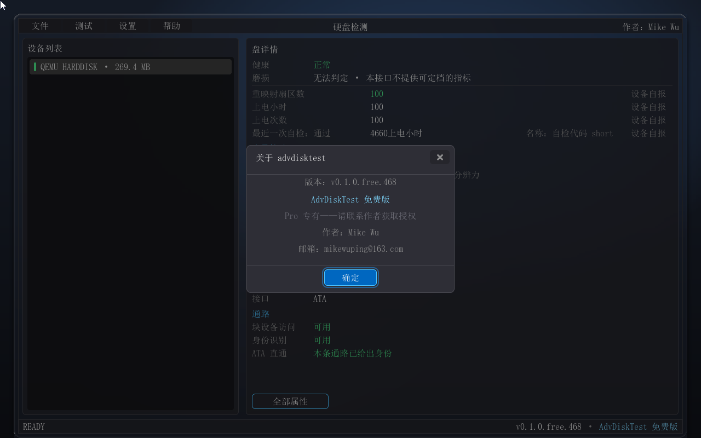

图 22　关于：版本、SKU 与作者信息
