# advmemtest 免费版技术手册

版本 0.1.7+562（免费版）· 适用环境：X64 UEFI Shell

## 前言


advmemtest 是运行在 UEFI Shell 下的内存压力测试工具，对标 Memtest86 全家，分免费版与专业版两个 SKU 发行；**本手册覆盖免费版**——经典测试集的全部能力，不需要任何授权文件即可使用。专业版在测试面与错误定位上的额外能力、以及获取途径，见第七章。本手册面向服务器与工作站的维护工程师、质检人员以及 DIY 玩家，假设读者熟悉 UEFI Shell 的基本操作，并对内存故障的基本形态（地址线、数据线、电荷保持、缓存干扰）有常识性了解。

手册按"看得见的功能 → 背后的引擎 → 错误处理 → 报告 → 高级特性 → 升级到专业版"的顺序组织。第二章介绍界面每一个区域的用途；第三章是测试引擎的全貌，16 条 pattern 的完整清单与两档线程模式逐一详解；第四章讲错误如何被发现、如何上报，以及免费版的工作口径（地址级）；第五章讲 HTML 报告；第六章讲自我重定位、厂商门控、多核降级等高级特性；第七章给出专业版的能力速览与获取途径；第八章集中回答常见问题。凡涉及真机行为的部分，本手册以 QEMU 验证环境为基准，真机差异以实测为准。**书中截图为示意构建**：各图右下角的版本水印是拍摄当时的产物号——本册 27 张图里 **21 张是 `562` 档**（含平台信息条的胶囊改版与 `起测 … · 已测 …` 计时、Pattern 对话框的新行序、带宽曲线、五卡档、DIMM 全部拓扑档、悬停气泡、运行/暂停态等）、**2 张是 `633` 档**（免费版设置菜单的 6 项形态（后两项为 Pro 锁定导流项）与测试配置底部的"禁用缓存测试模式（Pro）"锁定说明行，见 2.1/3.5）、**1 张"关于"对话框是 `594` 档**（宣传段分类名刷新），另有 **2 张报告渲染图**与 **1 张前言动图**（其内的版本行/帧为 `545`——报告与动图是渲染/录制的产物，不随构建号逐张重出）。水印与您手上这份的构建号不同属正常，图注所述功能仍以正文为准。

## 第一章 产品概述

### 1.1 产品定位

advmemtest 解决的核心问题，是把"内存有没有坏、坏在哪"这两件事同时回答清楚。传统内存测试工具（以 Memtest86 系为代表）能回答"有没有坏"，却只给一个裸地址——对"整根替换"的维修流程够用，对"精确到芯片"的更换决策不够（把错误指认到芯片、把坏页清单交出去的能力在专业版，见第七章）。免费版承担经典测试集的全部任务：地址、数据线、电荷保持与缓存干扰类故障的检测不需要任何授权；配合自我重定位（固定 64KB 自管新栈、栈水位遥测）让运行栈稳定可观测，多核真实并发（上限 16 核）让筛选变快。此外，电荷保持类隐性故障的检测，装机验收时的多核总线争抢类故障暴露，以及测试记录的存档流转，都在它的能力范围之内。

适用场景：个人验机、DIY 装机自检、维修现场快速筛选——13 条经典测试条目覆盖地址线、数据线、电荷保持、缓存干扰与随机性故障的大多数形态，两档线程模式与自我重定位全部可用；服务器验机、返修质检、向厂商索赔与内网机房的深度可靠性筛选，请见第七章。

### 1.2 运行环境与安装

- **固件**：X64 UEFI 固件。**三条启动路径都支持**：① 可直启 ISO——不需要 UEFI Shell，写入 U 盘（Rufus / balenaEtcher / Ventoy / `dd`）或挂到 BMC 虚拟光驱，开机从该设备启动即直接进程序；② UEFI Shell——绝大多数服务器与工作站 BIOS 的启动菜单中可直接选择"UEFI Shell"，进入后敲文件名启动；③ **UEFI PXE 网络启动**——免费版可以被 PXE 启动镜像直接拉起，但**镜像不含网络取件代码**，不消费站点授权 `site.lic` 与只读配置 `site.cfg`（没有 `LICENSE: pxe:` 行），也不受站点授权约束；同时 PXE 直启下程序目录是 PXE 设备、没有 SFS，本地 `ADVMTEST.CFG` 读不到也写不了，设置每次启动回到默认值。需要 PXE 站点授权下发与只读配置的部署请使用专业版（见第七章）。三条路径使用前都请**先关闭 Secure Boot**（程序未签名）。

**按启动形态选介质：能不能存下设置与报告**（实测口径：Ventoy **1.1.17**、Rufus 4.15、QEMU+OVMF；✅ 能 / ❌ 不能）：

| 启动形态 | 能启动 | 设置（`ADVMTEST.CFG`） | 报告（HTML） |
|---|---|---|---|
| Ventoy · 正常模式 | ✅ | ❌ 找到程序目录、但卷只读被拒 | ✅ 落在第一个 SFS 卷根（Ventoy 实测 VTOYEFI 分区根；串口 `fs0:` 是固定文案） |
| Ventoy · grub2 模式 | ✅（专业版需把证放在可读 FAT 盘根目录） | ❌ 连程序目录都定位不到 | ✅ 同上 |
| Rufus · ISO 模式（解到 FAT32 U 盘） | ✅ | ✅ 能存（U 盘可写） | ✅ |
| Rufus · DD/镜像模式（dd 直写） | ✅ | ❌ 卷只读 | ✅ 落在盘内 ESP 的空闲簇 |
| BMC / 虚拟光驱 | ✅ | ❌ | ❌ 没有可写卷 |
| PXE 网络启动（免费版） | ✅ | ❌ PXE 直启下本地 CFG 不可达（即使接盘），每次启动用默认值、不能保存 | ❌ 默认无盘：仅串口 WARN，以 STATUS/RESULT 为准；接可写 FAT32 盘可落报告 |

> **结论**：**本地启动**要让**设置和报告都稳稳落盘**，把 `efi` 拷到**可写 FAT32 盘**上直接跑（实测：当次 `cfg saved`、下次启动 `cfg loaded` 读回成功）。**PXE 直启例外**：设置不可保存，本地盘只影响报告。
> **实测范围**：`Rufus · ISO 模式`那一格是**结构等价实测**（FAT32 映像 + 解出的整棵树），真 Rufus 本体未驱动；`Rufus · DD/镜像模式`是真值实测。Ventoy 侧只在 **1.1.17** 上验过，其它版本未逐一验证。

- **外设**：鼠标与键盘均可操作，界面全简体中文（UTF-8）。
- **安装**：无安装过程。ISO 路径免安装（见上）；Shell 路径把与版本对应的二进制复制到 Shell 所在盘（通常为 fs0:）即可：免费版为 `AdvMemTestFree.efi`（发布时亦可改名 `advmemtest.efi`）。可选做法是写入 `startup.nsh`，开机进 Shell 自动运行。本版不需要任何授权文件；专业版另有授权要求，见第七章。

### 1.3 启动与版本

在 Shell 提示符下输入 efi 文件名回车即启动。启动后主窗口固定角落显示 `APP_VERSION`，格式为 `v<版本>.<SKU>.<构建号>`（如 `v0.1.7.free.562`），串口同步输出一行 `APP_VERSION=`，便于与构建记录核对二进制身份。

### 1.4 界面总览


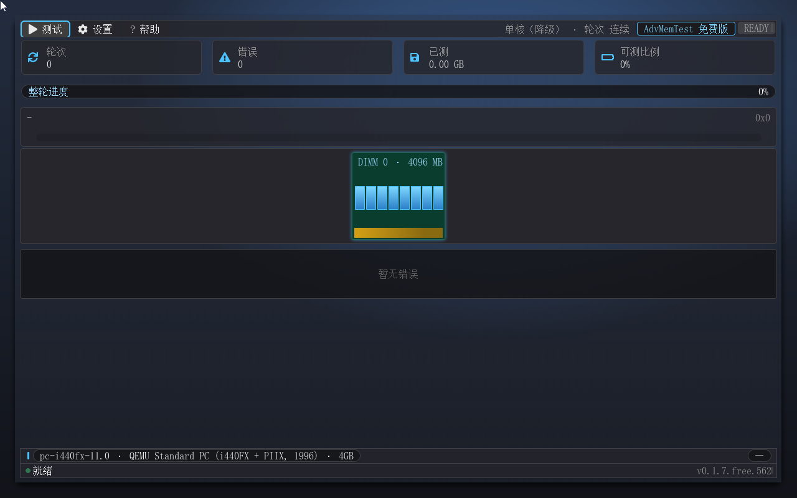

主窗口自上而下分为六个区域：菜单栏（测试 / 设置 / 帮助，右侧依次为模式面包屑、SKU 徽标、READY / RUNNING / PAUSED / PASS / FAIL 五态大字徽章）、统计卡区（常态四张；内存温度或 ECC 可读时多出第五张"内存健康"卡，见 2.2）、整轮大进度条、当前测试卡、DIMM 可视化带（槽位总数据 SMBIOS 动态决定，见 2.4）、错误日志区；再往下是**平台信息条**（一行：CPU · 主板 · 内存总量，右端计时）与**状态栏**两条窄条。第二章逐区说明。

## 第二章 界面导览

### 2.1 菜单栏

菜单栏覆盖全部操作入口。"测试"菜单的第一项是三态动态切换的：空闲时为"开始测试"，运行中变为"暂停测试"，暂停后变为"继续测试"，另有一项"停止测试"恒在——它是唯一的停止入口（见 2.6），第三项是"**内存带宽基准...**"（见 6.6——它是只读的查看页，测试运行中同样可以打开）。**"停止测试"按状态收敛可点性**：空闲（尚未开始测试）时它呈灰色且点不动——没有可停的对象时，灰显比"点了没反应"更诚实；测试运行中与暂停中它恢复为正常亮度、可点。菜单栏"测试"按钮的图标与第一项文案同拍切换：运行中为暂停图标（⏸，点击动作=暂停）、其余状态为播放图标（▶，点击动作=开始/继续），与右上角五态徽章联动。

"设置"菜单六项：**"测试 Pattern 选择..."、"线程模式..."、"测试配置..."、"外观..."、"体验功能…"与"内存信息…"**（菜单名省略号为产品界面现状——前四项用半角三点，后两项锁定项用标点省略号，本文档镜像之）。后两项在免费版里是**锁定导流项**：灰显 + 锁形图标（带"（Pro）"后缀），点击只弹出"Pro 专属功能——请联系作者获取 Pro 版授权"提示；**免费版镜像不包含这两个对话框的实现代码**——体验功能（错误注入演示）与内存信息（SPD 深度页）只在专业版产物中存在，这里看到的是升级入口，不是被裁剪一半的功能本体。

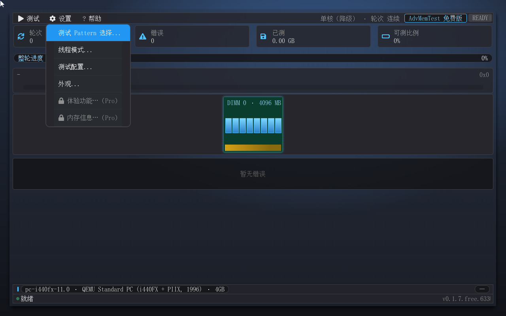

"帮助"菜单两项：第一项打开关于对话框（快捷键 F1），第二项"退出"弹出退出确认对话框（与空闲 Esc 同一个确认框，见 2.6）——任何时候都有显式出口，不必记快捷键。菜单栏右侧是状态徽章，五态指示：READY（待机）、RUNNING（运行中，蓝色呼吸动画）、PAUSED（已暂停，琥珀色）、PASS（本轮达标完成、无错误）、FAIL（检出错误）。徽章左侧是模式面包屑，常驻显示当前模式（如"单线程 · 轮次 连续"、"多线程 4 核 · 轮次 第 1/10 轮"），点击可直接打开线程模式对话框。面包屑与徽章之间是 SKU 徽标：免费版为亮蓝色（#7FD8FF 字 + 强调色 #4CC2FF 描边）"AdvMemTest 免费版"。

**键盘与鼠标说明**：菜单与对话框的滚动以键盘 Tab（焦点循环）/ 上下键为主，**鼠标滚轮同样可用**——指针悬停在滚动容器（对话框清单、帮助正文等）上滚动滚轮即可，容器内的提示条会给出用法（"鼠标滚屏：滚轮滚动，或按住左键拖动"）；侧边滚动条为显示指示件。对话框内请用 Tab 切换焦点、回车确认。对话框沿用主界面灰阶体系（深色化 + Fluent 分栏：标题栏/右上角 ✕ 关闭钮/分隔线/强调色焦点辉光），与主界面风格统一，焦点光圈为强调蓝，任何背景下清晰可见。

### 2.2 统计卡区（四张 + 可选的"内存健康"卡）

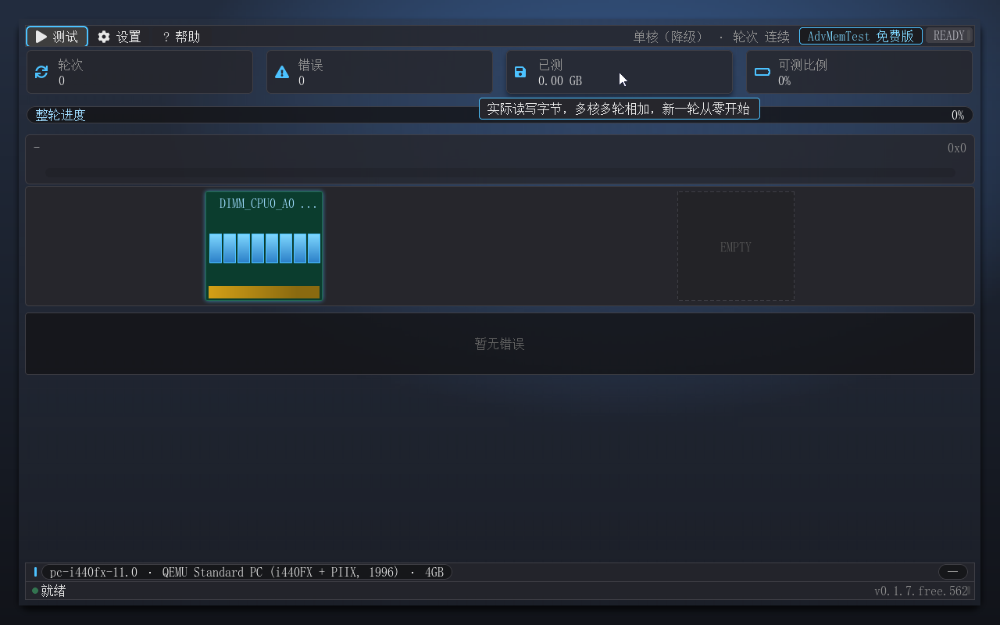

四张基础卡片依次是：**轮次**（当前完成轮数）、**错误**（累计错误数）、**已测**（实际读写字节数，多核多轮相加，新一轮从零开始）、**可测比例**（可测内存与物理内存的比值，测试中不变化——为何不是 100% 见第八章）。鼠标悬停任意卡片会弹出语义说明浮层。其中**"可测比例"卡的浮层另有累计覆盖读数**：`累计覆盖 X%（已覆盖 N / 可测 M）`——一轮完整跑完约 100%，多轮或连续运行继续累加，可以超过 100%；报告汇总区给出同一个数（见 5.2）。

**第五张"内存健康"卡是按可读性出现的**：它的两个字段各自独立——温度读不到就只显示 ECC，ECC 读不到就只显示温度，**两个都读不到时整张卡不出现**（布局自动回落到四张，与没有这张卡时逐像素一致）。**免费版只有 ECC 一面可能亮**：免费版镜像里不编入 SPD 栈，温度源由构造不存在（见 4.2 与 6.2），因此免费版不会出现任何温度读数，也不会出现空着占位的温度字段。

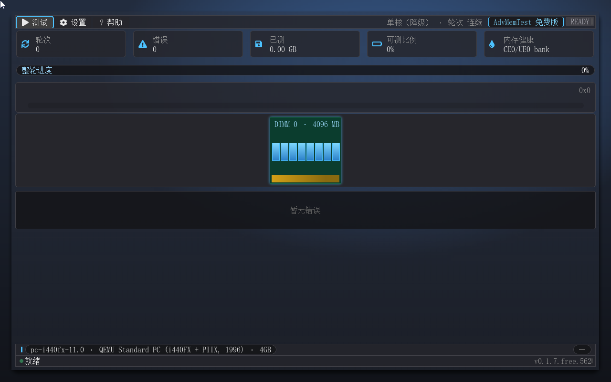

ECC 字段的口径要点与"错误"卡完全不同，务必分清：**它数的是"挂着有效记录的 MCE bank 数"，不是错误次数**——所以卡面数值串带 `bank` 单位（如 `CE0/UE0 bank`），悬停浮层里也把这句话写全并显式点出"不是错误次数"。计数读不到、或平台没有可枚举的 bank 时，ECC 字段**整段不显示**（不写 `CE0/UE0` 充数）；若有一部分 bank 没读到，数值后**必须**带限定语（卡面短式"（N 未读）"，浮层另给分母"其中 N 个 bank 未读到（共查了 M 个）"）——"没读到"不允许被读成"没错误"；有记录但分类不出来的 bank 单独一句"（N 未识别）"，不计入 CE/UE，也不说"无错误"。最后，"只读不清"：记录由平台清除，本工具只读不清（浮层末行）。

### 2.3 整轮进度条与当前测试卡


进度条为 22px 全圆角蓝渐变长条，左侧标签、中间显示当前测试地址、右侧显示大号百分比，下方附一条紫色测试副条。进度条走满 100% 即完成一轮，进入下一轮（连续模式下永不封顶）。当前测试卡显示正在执行的 pattern 名称与段 / 偏移 / 相位坐标，配合进度条可以判断此刻压在内存的哪个区域。

### 2.4 DIMM 可视化带


这是本工具最具辨识度的界面元素。槽位布局由 SMBIOS 双入口驱动（Type 16 的槽位汇总定网格总数、Type 17 的已插图定点亮与几何/颗粒），**槽数随平台动态变化**：从单槽到双路服务器的 32 槽直至上限 48 槽，均按"每行最多 8 列"的规则自动排布。行数不超过 2 行时使用全样式——每根内存条按颗粒组织渲染颗粒图标，颗数取自颗粒几何模型（数据颗粒 + ECC 颗粒 + RCD：x8 模块 8 颗、带 ECC 9 颗、RDIMM 再加 RCD 为 10 颗；阵列上限 16 颗、超过按上限截断，该上限在 x4 模块上才会触及），与模组实际芯片布局一致；器件位宽为**推测值**时 tooltip 会标注。行数达到 3 行及以上自动切换紧凑样式（模组高压缩、颗粒以刻线示意，PCB、金手指与槽名/容量丝印保留）。**少槽降档**：已插图根数不超过 2 根时（单槽/双槽小平台）模组降为紧凑档——模组高 140px、宽固定 150px、水平居中于轨道，颗粒区按新高度重排铺满面板，避免"单根大模组上一小撮颗粒"的失衡观感；16 槽等全样式基线（2×8、模组高 177px）不受降档影响。测试时当前活动槽有蓝色光晕，光晕随测试地址流动。鼠标悬停任意点亮槽位弹出 tooltip，显示插槽名、容量、组织、颗粒数（位宽为**推测值**时标"（推测）"，位宽未知时不显示位宽与颗粒数），第二行给出 rank 数与内存技术（rank 取 Type 17 记录真值；记录未报该字段时按 1 rank 显示并同样标"（推测）"）：

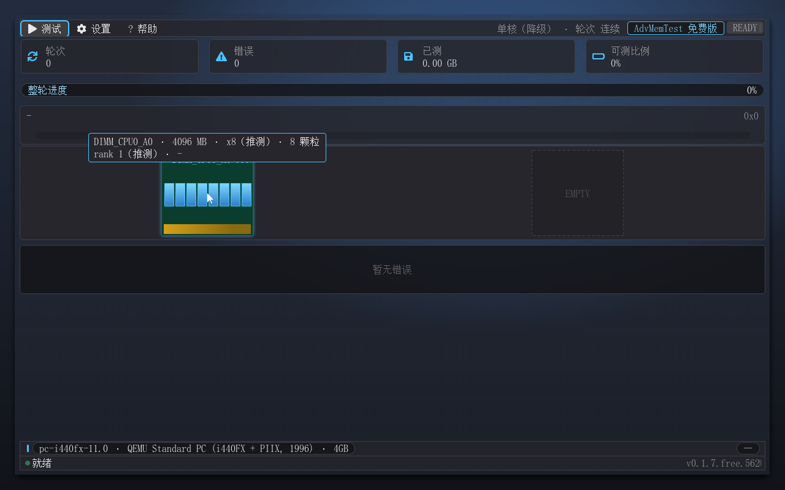

**器件位宽从哪来**：位宽只有 SPD 能提供（SMBIOS / ACPI 全谱系都没有该字段，Memtest86 系同源），免费版不读取 SPD——因此非真值一律按 **x8 推测并强制标注**（tooltip 内的"（推测）"），位宽未知时不印位宽与颗粒数。推测值绝不当事实呈现。

槽数决定的外形档位都有实测截图对应：单根平台为紧凑降档（模组 140px 高，含 1px 描边；颗粒铺满面板），双根同款每根各居半带；3 槽与 4 槽平台回全样式（单行全样式——行高由区高驱动约 **360px**，逐颗粒渲染；**177px** 为 16 槽 2×8 两行基线的行高），16 槽即 2×8 全样式基线。紧凑档与全样式的外观差异一图可见：

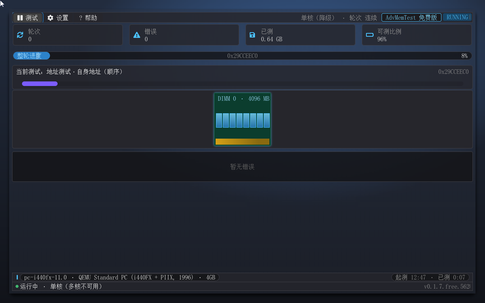

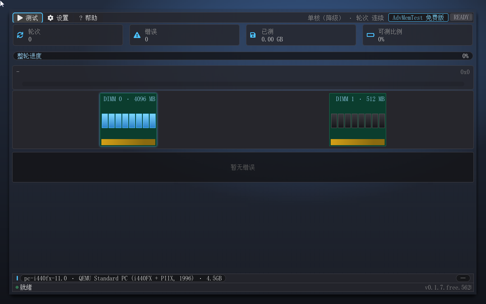

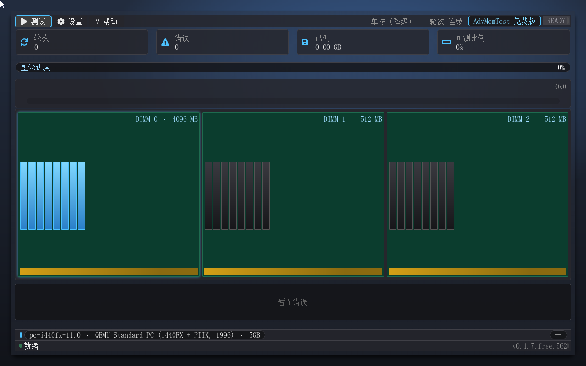

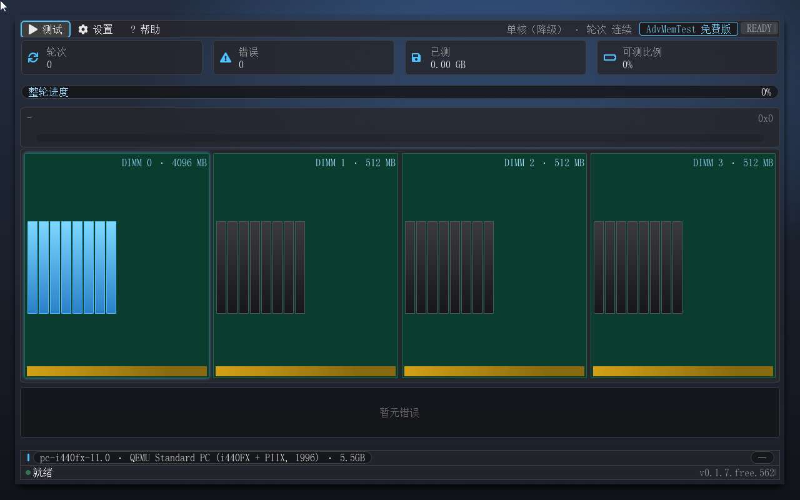

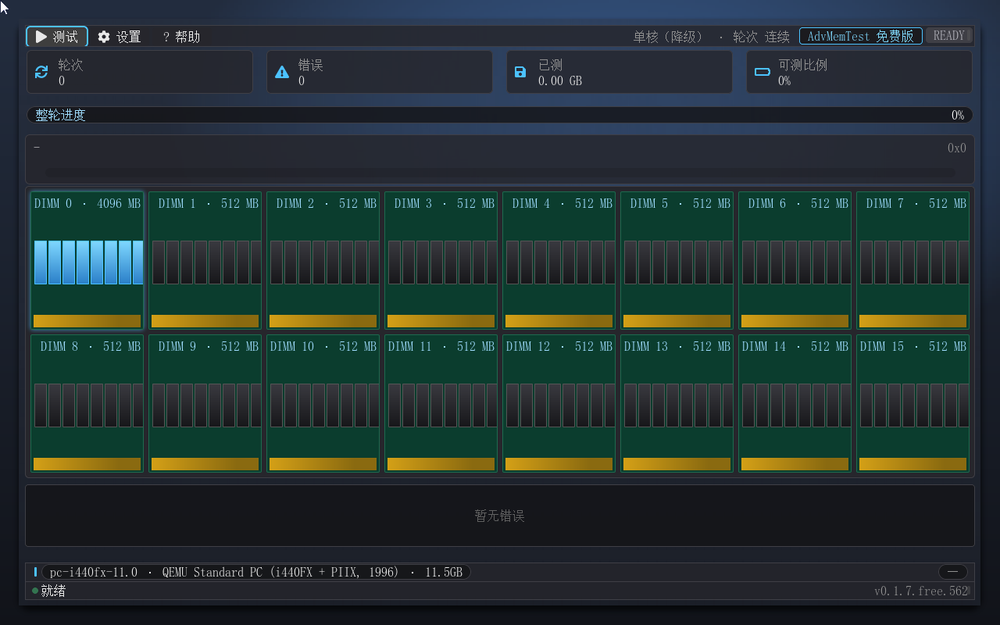

两个平台事实必须明说：**空槽置灰**——想"哪几槽空着"一目了然时，空槽以虚线框 + `EMPTY` 丝印呈现（真机服务器板把全部槽位列出、Size=0 表述空槽，本带按实渲染）：

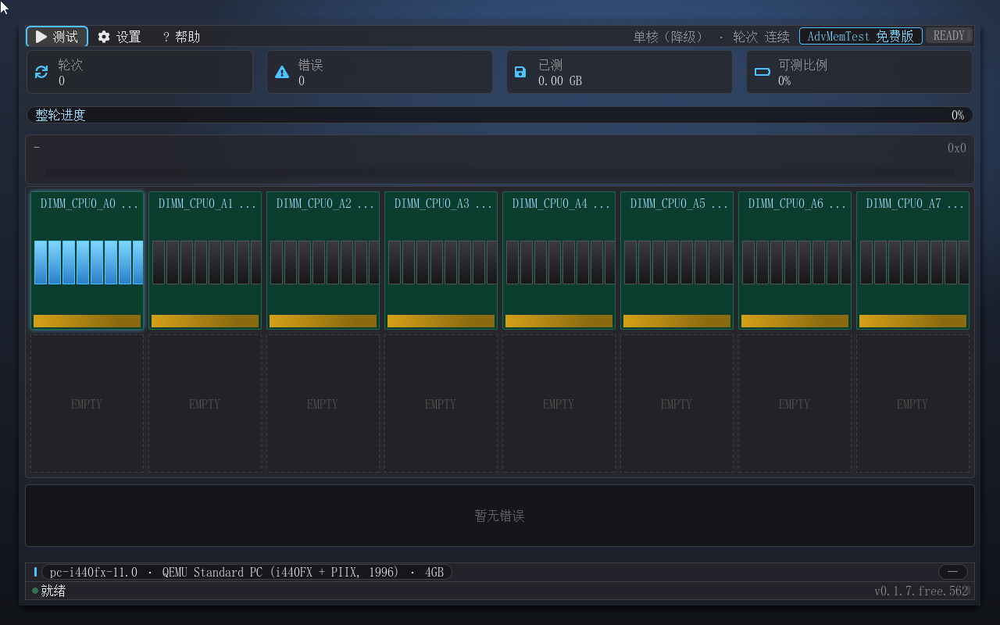

**分组头**——当 SMBIOS 提供可用分组信息（如双路平台的 DeviceLocator 前缀或多组 Type 16 数组）时，带顶渲染"组名 · N 槽"组头，槽序保持稳定（末尾数字段自然序，不会出现 A10 排在 A2 前的"跳排"观感）。32 槽双路平台即 8 列 × 4 行紧凑样式（每组 2 行）+ 两组头：

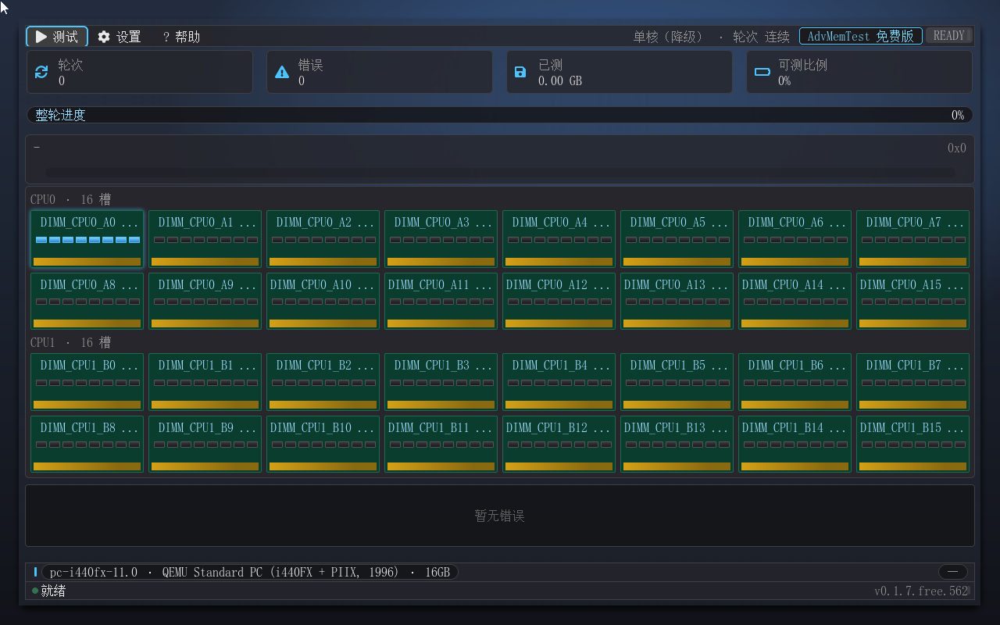

槽位总数超过 48 时按 48 满格兜底展示，带内黄字提示"本平台槽数 N 超出可视化上限"。免费版中 DIMM 带为**纯拓扑显示**——错误可视化形态见第四章。

### 2.5 错误日志区、平台信息条与状态栏

错误日志区固定在窗口底部，滚动显示最近 4 行错误，与串口构成错误上报的两条文本通道（免费版的完整口径见 4.1）。日志每行含地址、期望、实际、异或四项；不含定位字段——定位信息在免费版的信息源头就不产生（见 4.2）。

**平台信息条**紧贴状态栏上方，一行两类信息。左段是三个字段、以中点分隔：**CPU · 主板 · 内存总量**（如 `i7-12700 · ASUS Z690 · 32GB`）——CPU 型号、主板厂商型号与固件报告的物理内存总量，起测前用一眼确认"现在测的是哪台机器"。字段不带标签，出现顺序固定为 CPU、主板、内存。宽度不够时按**固定优先级 CPU > 内存 > 主板**让位：先截主板尾部并加 `…`，还不够就**整个略去主板**（连同它前面的分隔符），全程不折行、不缩字号。**内存总量带 `+` 后缀时表示"至少"**（如 `24GB+`）：本带与 DIMM 可视化带共用同一个 SMBIOS 槽位域，槽位总数超过 48 的平台上第 49 条起的 Type 17 记录不参与汇总，此时求和是个**下界**，必须外显——不带 `+` 的读数才是精确值。

右段是**计时**，形态 `起测 14:32 · 已测 1:23`——**两段都带标签**（标签为界面文案的一部分，免得把"开始时刻"读成"还要测多久"）：前面是**起测时刻**（固定 `HH:MM` 24 小时制两位），后面是**已测时长**。时长分两档：不足 1 小时用 `M:SS`（如 `1:23`），满 1 小时起用 `H:MM:SS`（如 `1:05:03`）。三条行为必须知道：**① 未开始测试时显示 `—`**（破折号，不是 `00:00`——后者会被误读成"测了 0 秒"）；**② 已测时长是累计测试时间，暂停期间不计入**（问的是"测了多久"，不是"挂了多久"），暂停时整条右段一并冻结、连秒都不走；**③ 停止后冻结在最终值**，不归零、不清空，直到下一次起测才重新计时。

**起测时刻的口径必须说清（客户答疑常见项）**：它取的是**固件墙钟**（UEFI 运行时的 `GetTime`），而 UEFI 规范只要求它返回"当前时间"、**没有规定时区语义**——固件可能把实时时钟当 UTC 用，也可能当本地时间用，取决于机器与固件设置。因此**这一栏不保证等于你手表/手机上的时间**，差若干整数小时是预期行为，不是缺陷；这与"已测时长"无关（时长是单调累加的真实值，不受此影响）。个别平台没有实时时钟、`GetTime` 失败时，只显示"已测 …"、不印假时刻（也不印空的"起测"标签）。

状态栏显示运行模式文案：多核模式下为"N 核并行"；MP 协议缺席或单核平台自动降级单核时，状态栏会注明降级；暂停时显示"已暂停 · Esc 继续 / 菜单停止"。状态栏左端还有一枚呼吸点动画，指示界面事件泵在正常工作——运行中呼吸闪烁，暂停时定暗。

**倒计时起测的状态栏提示**：主界面就绪后，若"倒计时自动开始测试"开着（缺省开，见 3.5），状态栏会逐秒显示 `将在 N 秒后自动开始测试（按任意键取消）`，归零即自动起测；倒计时期间任何一次按键或鼠标移动都会取消它——取消后**本次运行不再自动起测**（一次性），想跑测就手动起测（见 2.1）。

### 2.6 Esc 语义


Esc 键按上下文逐级生效，优先级从内到外：关闭二级消息框 → 关闭下拉菜单 → 关闭对话框 → **运行中暂停测试** → **暂停中继续测试** → **空闲时弹出退出确认**。

与许多内存测试工具"Esc 直接结束"的习惯不同，advmemtest 的 Esc 在测试运行中是**暂停**而不是停止——避免误触导致长时间压测白跑。运行中按 Esc，测试即打住（进度、错误现场全保），再按一次 Esc 继续；要真正结束测试，请打开"测试"菜单点击"停止测试"（或从暂停态点击）。只在空闲（未运行）状态下，Esc 才会弹出退出确认对话框，确认后才会退出程序。对话框打开时 Tab 键被焦点圈锁定在对话框内循环，消息框打开时 Tab 无操作。

上面那条 Esc 链是**防误触**设计：正因如此，测试运行中按 Esc 只会暂停、不会退出。要**显式退出**而不必先停测试，走"帮助 → 退出"菜单项——它与空闲 Esc 共用同一个退出确认对话框，但**不经**"运行中 = 暂停"那道护栏，测试跑着也能一步到位；这一层的保护由确认框自身承担：正文明确提示"测试进度将丢失"，并附"退出后回到固件引导流程；若控制台无响应请断电重启"的提示。换句话说，运行中退出是**允许**的（显式菜单入口 + 二次确认），只是不会被 Esc 意外触发。

## 第三章 测试引擎

### 3.1 内存占用模型

advmemtest 运行在固件之上，不能像裸机 memtest86 那样直接测全部物理内存。启动时它枚举内存映射中的可用区域（EfiConventionalMemory），逐段以 AllocatePages 占用，测试结束后（停止 / 退出）全量归还；固件头部预留 128MB 不纳入测试。占用模型决定了两个界面上看得到的量：可测比例是"可测内存 / 物理内存"，测试中的已测字节数则是跨核跨轮的真实读写量。

### 3.2 Pattern 注册表（16 条：14 条用户可见 + 2 条引擎自检参考条）

以下 16 条 pattern 全部为真实写读实现，免费版全量可执行。其中 Id 11/12 两条是引擎内部自检参考条——"空测试"与"热复位校验"，仅供 SelfCheck 与引擎内部使用，对话框中不展示；因此**用户可见可勾选的是 14 条**（新增的 Id 33 总线应力默认不勾选，见下）。表格中"多核资格"指该条在并行模式下的调度方式：**切分**（地址按核均分、可并发）、**轮换**（逐核轮换跑、天然串行语义；**缺省只由 1 核跑完整内存**，覆盖等价且不做 ×N 重复全量，可用 `par.rotate.cores` 调宽，见 6.5）、**恒 BSP**（固定由引导核执行，多为依赖全局静置相位或跨边界邻接的条）。

| Id | 名称 | 说明 / 检测目标 | 多核资格 |
|---|---|---|---|
| 0 | 地址测试·步进 1（无缓存） | 每个地址写步进位模式，检测地址线故障 | 轮换 |
| 1 | 地址测试·自身地址（顺序） | 地址即数据，顺序写读（与 Id 2 同一实现，逐 qword 独立，可地址切分） | 切分 |
| 2 | 地址测试·自身地址（并行） | 地址即数据，并行写读（多核分化） | 切分 |
| 3 | 移动反转·全 1 全 0（并行） | 全 1 与全 0 并行移动反转，数据线翻转故障 | 切分 |
| 4 | 移动反转·8 位 pattern | 8 位走花移动反转 | 切分 |
| 5 | 移动反转·随机 pattern | 随机数移动反转 | 切分 |
| 6 | 块移动 | 块拷贝压测，缓存与突发路径 | 切分 |
| 7 | 移动反转·32 位 pattern | 32 位走花移动反转（跨地址错位依赖） | 恒 BSP |
| 8 | 随机数序列 | 随机数序列写读校验 | 切分 |
| 9 | Modulo 20·随机 pattern | 每 20 字节错位写，绕开缓存干扰 | 切分 |
| 10 | Bit fade·双 pattern | 写入后静置再校验，检测电荷保持（刷新）故障 | 恒 BSP |
| 11 | 空测试（自检用） | Null test，不触碰内存（对话框不展示） | 恒 BSP |
| 12 | 热复位校验 | Warm Reset 后校验上段内存（QEMU 环境为占位实现；对话框不展示） | 恒 BSP |
| 13 | Row Hammer（行锤击） | 行锤击：高频激活邻行检测干扰错误 | 恒 BSP |
| 14 | SIMD-128 宽访存 | SSE2 单指令 16 字节写读校验 + 宽移动反转 | 切分 |
| 33 | 总线应力·突发转向 | 变长突发写读交替 + 空闲间隙，针对内存接口/时序窗口故障（默认不勾选） | 切分 |

另有 20 条高级条目属**专业版域**（Id 15–32、34、35：Advanced 系工程序列、三家内存原厂的专用算法、两条域宽增补条、Id 15 的 SIMD-256 宽访存、Id 34 的 **Adv 缓存驻留压力**，以及 Id 35 的 **Adv BG 条纹扫描**）——它们在 Pattern 对话框中以灰显行 + 锁标列出：内容可读、焦点圈可落（键盘能浏览），但不可勾选，见 3.3 与第七章。

#### 地址类（Id 0–2）

地址测试检测的是地址线故障：地址线开路、短路或译码错误，会让写进 A 地址的数据从 B 地址读出来。步进 1 模式每个地址写步进位模式再读回，自身地址模式则直接以地址为数据。"并行"变体让多个核同时写读各自区域，把多核总线与切分边界上的译码错误也带出来。

#### memtest86+ 系（Id 3–10）

这一组是 memtest86+ 的经典序列：移动反转族（全 1 全 0、8 位、随机、32 位四种走花）以相反数据反复写读相邻地址，专门暴露数据线翻转类故障；块移动压测缓存与突发路径；Modulo 20 以 20 字节错位写、绕开缓存行干扰直达存储阵列；Bit fade 写完后静置一段时间再读回，检测 DRAM 电荷泄漏——刷新电路弱化、单元漏电偏大的颗粒会在这里现形。v2 邻接相：64B 行交替反相填充 → 静置 → 校验，针对相邻行耦合/保持干扰。

#### 行锤（Id 13）

Row Hammer 高频激活相邻行，诱导邻行单元干扰翻转——这是 2014 年以来所有内存可靠性测试的必考项。advmemtest 的实现为全地址域的邻行锤击序列，因依赖跨切分边界的行邻接，固定由引导核执行，确保锤击范围完整。**本条两版都有**（默认勾选）。行锤 v2：双侧 aggressor（T-1/T+1）+ 周期性缓存冲刷（wbinvd），校验 victim 行 T；语义演示环境（QEMU）下无真实 DRAM 行激活。

#### SIMD 宽访存（Id 14）

这一组补的是**宽访存路径**：前面所有条都用普通标量读写逐字节/逐字压测，SIMD-128 改用 SSE2 单指令 16 字节整宽写读，先宽写再宽读回逐字节校验，再做一轮宽移动反转（把整条 128 位向量按位取反后写回、再校验）。它覆盖的是窄访存压不出来的位耦合与地址线形态——宽突发、宽预取路径上相邻字节共用同一次访问，颗粒内部或数据线上的位间串扰更容易在这里现形。SSE2 是 x86-64 的**基线指令集**（架构上无条件可用），因此这一条在免费版与专业版都默认勾选，不需要任何额外前提。

#### 总线应力（Id 33）

本条是 2026-10 新增的免费域条目（默认不勾选）：以 64/128/256/512 字节轮转的变长突发做交替极性写读（偶次全 0、奇次全 1），每个突发写完插入一段空闲间隙再读回校验——针对内存接口与时序窗口类故障。需要说明其边界：软件路径上的"间隙"只是 CPU 侧自旋，并不产生真实的 DRAM 接口空转，因此它在 QEMU/软件环境下是访问结构、极性与"写完即读"的语义演示；真实总线时序故障需平台层总线测试硬件对接。**默认不勾选**（语义演示条，且间隙自旋使吞吐显著低于其它条），需要时在 Pattern 对话框手动勾选。

#### 引擎自检参考条（Id 11–12）

这两条不在用户可选集内：空测试不触碰内存，用于自检时建立"零触碰也零误报"的基线；热复位校验在自检流程中核验上段内存的可读性（QEMU 环境为占位实现）。`advmemtest.efi selftest` 会逐条写读自检全部 pattern 并故意翻转一位做五链路断言，串口以 `SELFTEST: ALL PASS` 收尾。

### 3.3 Pattern 选择对话框


对话框列出全部 34 条**用户可见** pattern（本版可执行的 16 条减去 2 条引擎内部自检参考条 Id 11/12，加上 20 条未授权条目；两版目录数据同源同名），按类别组织，勾选即选中。**未授权条目按版本能力锁定**：免费版中专业版域条目（**Id 15–32、34、35**，含 Id 15 的 SIMD-256 宽访存、Id 34 的 **Adv 缓存驻留压力**与 Id 35 的 **Adv BG 条纹扫描**）**灰显 + 锁形图标**——内容可读、焦点圈可落（键盘能浏览），但**不可勾选**，点击按 Enter 均弹出提示"Pro 专属功能——请联系作者获取 Pro 版授权"（如需读取详细参数后在整机上完整压测，商业升级路径见第七章）。全部 14 条免费域条目正常可勾选。

默认集为 13 条（Id 0–10、13、14；Id 11/12 自检参考条不参与默认集与全选——引擎内部自检用；新增的 Id 33 总线应力同样**默认不勾选**，免费版默认集不随厂商信息变化）。全选会选中全部 14 条可勾选条目，手动勾选以"全部可执行条目"为上限。清空所有勾选会触发双防护拦截，不会带着空集起测。对话框的焦点圈长度为 34 行 + 4 个命令按钮。

**对话框按 Id 升序渲染**（2026-09-20 起：**注册表顺序即对话框顺序**，实现里没有第二处顺序真源）——Id 0–14 的共用条目排在前面：经典条目之后紧跟**行锤（Id 13）与 SIMD-128（Id 14）**，再往后是 Pro 块（Id 15–32，另有后置 Id 34/35）；**Id 33（总线应力）是后置的免费域共用条目**，位于 Id 34/35 之前。**Id、掩码、串口、报告与自检一律按 Id 走**，顺序只影响这一处观感。

### 3.4 线程模式（两档）

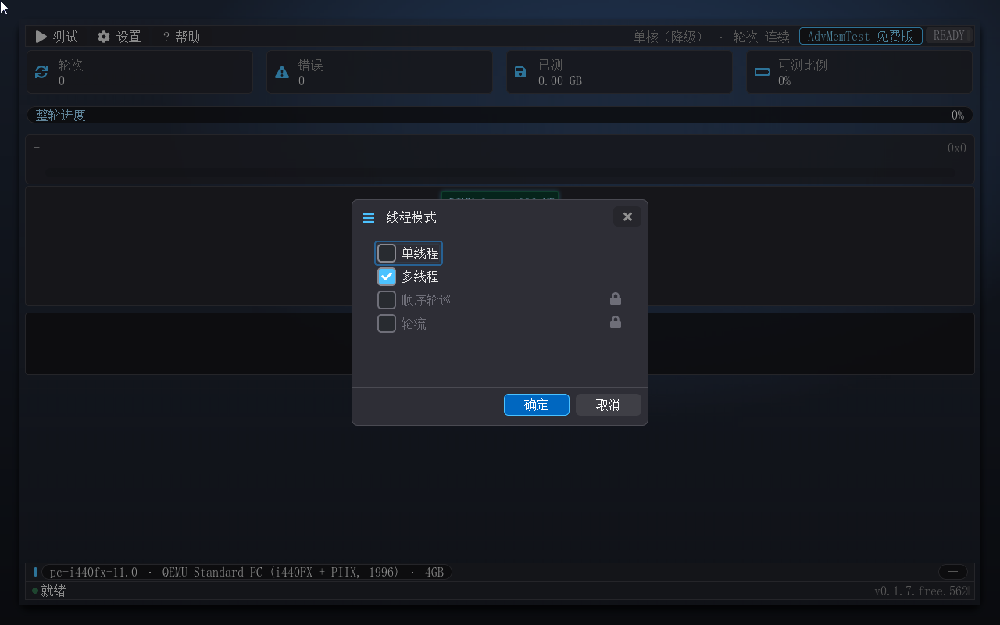

线程模式对话框提供两档调度语义，对应不同的验收场景（另两档——顺序轮巡与轮流——属未授权能力，灰显 + 锁标，见第七章）：

**单线程。** 全部工作由引导核执行，每条 pattern 逐段推进。适用场景：MP 协议缺席的单核平台、需要精确复现某个错误的定位排查。它是唯一不依赖多核的兜底模式。

**多线程（地址切分并发）。** 把已占用的内存段按核数均分，各核同时压测自己的区段，仅对"可切分"资格的 pattern 生效。这是默认推荐的筛选模式：实测 4 核吞吐约为单核 2.5 倍，大容量机器做全量筛选时省时显著，且各核同时写读相邻区段，能暴露总线争抢、刷新窗口重叠类的多核故障——这是单核轮巡永远碰不到的工况。


依赖 MP Services 真实调度，多核参与数有界：**免费版上限 16 核**（对齐 Memtest86 Free）。QEMU 闭环已验证 ≤16 核与全部降级路径。降级行为：任何非单线程请求在 MP 协议缺席或单核平台上自动降级为单线程，状态栏注明降级，测试照常进行，不会中途报错。多核模式下错误收割也走多核通道：各核把错误写入免锁槽组，引导核逐核收割并打串口 TEST_FAIL 行（带 cpu= 号），保证多核压测的现场不丢（见 4.1）。

实现上的两个工程细节：BSP 工人+协调者双角色——界面泵、进度聚合、错误收割、串口输出全在引导核，AP 常驻工人不再需要参与界面；每核邮箱与错误缓冲按实测核数在运行时分配（每核约 2.9KB 量级，分配失败自动降级单核并在状态栏注明）。

**多核起测的 `perf:` 工作量诊断行（FB-40）。** 本版起，`PAR_ROTATE`（逐核轮换）条目在**多线程**模式下的缺省行为是**只由 1 核跑完整内存**：一条 pattern 由一核完整覆盖（覆盖等价；核间/核内访问路径不因多核而增加），但工作量不再乘核数。需要调整轮换宽度时，在 `ADVMTEST.CFG` 写一行 `par.rotate.cores=<n>`（见 6.5）：`1`（缺省）= 单核轮换；`2..16` = 参与核数上限（免费版核数上限 16）；`0` = **旧版全核各自全量**（慢，只在确实需要每核都走一遍的压测里用）。多核参与且待测集合里含有 `PAR_ROTATE` 条目时，起测瞬间串口会多打一行 ASCII 诊断（每个测试系列打一次）：

```
[AdvMemTest] perf: 2 cores x 1 full-memory pattern(s) (PAR_ROTATE); rotate on 1 core(s); work ~ rotate x memory x patterns - use preset=quick or fewer patterns
```

`N cores` 是本次实际参与核数（免费版上限 16），`rotate on K core(s)` 是**实际参与轮换的核数**（缺省 1；`par.rotate.cores=0` 时为全核），`M` 是选中且可执行的 `PAR_ROTATE` 条目数；工作量 ≈ K × 可测内存 × 条数。**本行只做诊断**，不改判定、并行资格与进度分母；单核（含 MP 缺席、AP 拉起失败或模式降级为单核）不打印。

### 3.5 轮数配置


测试配置对话框设定轮数上限：1–99 轮，或勾选"连续"不限轮次。连续模式下跑满 99 的取值为不封顶，测试一直进行到手动停止为止；指定轮数跑满即"达标完成"，自动写报告。整轮进度条每轮走满一次，轮次统计卡同步累计。对话框内另有一行**"无人值守状态汇报"**复选框及其分钟档（1–60 分钟；**默认勾选、缺省 1 分钟**，未勾选时该行置灰）——为 BMC / 自动化脚本提供周期性状态行，见 6.7。

对话框下半部还有一组**倒计时自动开始测试**设置：复选框（缺省勾选）+ 其下的"倒计时时长（秒）"步进行（范围 3–120、缺省 10）。勾选时，主界面就绪后倒计时归零即自动开始测试——用的是**你当前设定的待测集合**（与菜单"开始测试"完全同一个入口，不是另一套默认集）；倒计时期间按任意键或移动鼠标即取消，且本次运行不再自动起测（一次性）。不想要自动起测就取消勾选（此时时长行置灰、不可调）。两项设置随 `ADVMTEST.CFG` 持久化（`auto.start` / `auto.start.secs` 两键，见 6.5）。

对话框底部还有一行**"禁用缓存测试模式（Pro）"锁定说明**（灰字 + 锁标，**没有复选框、不进焦点圈**）。它是专业版能力的导流占位：缓存旁路（CR0.CD）的实现不编入免费版镜像，配置里的 `cache.bypass` 键同样被忽略（串口留一行 `[AdvMemTest] cache bypass setting ignored (Free build)`）；专业版在同一位置渲染的是真复选框（见专业版手册 9.2）。**缓存开/关 A/B 对照（`cache.ab`）同样属于专业版能力**：免费版读到该键会忽略并留一行 `[AdvMemTest] cache.ab setting ignored (Free build)`，不产生两轮强制或报告节。**坏区排除与定点复测（`retest=exclude|focus`）也只属于专业版**：免费版忽略该参数并留一行 `[AdvMemTest] retest ignored (Free build)`，不读 `badram.txt`、不改变测试视图。**跨会话趋势同样只属于专业版**：免费版不写 `advmemtest_sessions.csv`，报告也没有“历史趋势”节。**料单核验（`bom=check`）也属于专业版**：免费版忽略该参数并留一行 `[AdvMemTest] bom ignored (Free build)`，不读 `expected_bom.csv`、无核验节。

### 3.6 暂停与继续（防误触保护）


长时间压测最怕误触：一按 Esc 几小时的进度全没了。advmemtest 因此把 Esc 的语义从"停止"改为"暂停/继续"，并提供两条等价入口——键盘 Esc 与"测试"菜单第一项（运行时显示"暂停测试"，暂停后显示"继续测试"）：

- **运行中暂停**：按 Esc 或点"暂停测试"。引擎立即冻结：整轮进度条、当前测试卡、DIMM 光晕全部停在原地，误差不会继续扫描；界面同步进入暂停态——右上角徽章变 **PAUSED（琥珀色）**（运行中为 RUNNING 蓝色呼吸），状态栏显示"已暂停 · Esc 继续 / 菜单停止"，呼吸点、进度条流光、颗粒微光等动画节拍一并停止。
- **暂停中继续**：再按 Esc 或点"继续测试"，从暂停前的地址无缝接续——进度、错误计数、轮次全部保留。
- **暂停态同样可以停止**：点"停止测试"直接终结整个测试系列并写报告（见第五章），此为唯一停止入口。

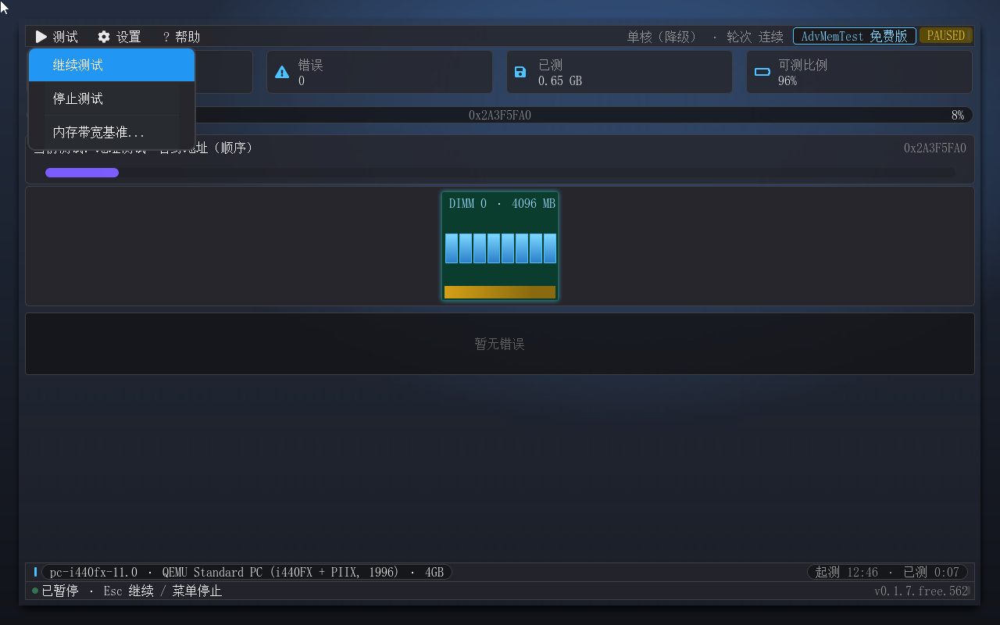

实现上的两个工程细节：单核下暂停即主循环步进器冻结；多核并行时，引导核通过每核邮箱把"暂停"标志广播给所有 AP——AP 正在跑的切片跑完即停，尚未开始的切片在原位悬置，恢复后原样捡起继续，进度一处不丢。暂停期间错误通道与自检日志都不受影响，恢复后照常收割。

## 第四章 错误处理

### 4.1 错误三通道（免费版口径：地址级）

检出错误后，同一个错误同时走三个通道上报（免费版口径）：

- **界面错误日志区**：滚动显示最近 4 行错误，每行含**地址、期望、实际与异或**四项，**无定位后缀**。
- **串口一行 `TEST_FAIL`**：多核模式带 cpu= 号（可直接对接自动化日志采集），行内无定位后缀——核号是执行语境而非内存位置，因此保留；行尾附 `t=<h:mm:ss>` 时刻，再附 ` pat=<Id> cls=<类别>`（产生该错误的 pattern Id 与错误类别，见下）。
- **DIMM 可视化带与徽章**：DIMM 带保持纯拓扑显示（**错误红标不点亮**），徽章转 FAIL。

`t=` 为该错误的**已测时刻**（暂停不计入），与 STATUS 心跳 `elapsed` 同轴；首错（本会话第一条被收割到的错误）时另有独立一行 `FIRST_FAULT: t=… addr=… cpu=…`。多核下"首错"取**首次被引导核收割到**的那条（收割按核序），不保证是严格全局最早的一条。

免费版的错误记录在**信息源头**就不产生定位字段：错误记录、串口、报告、界面四条链路的定位代码整组不编入免费版二进制，不存在"计算了但没显示"的浅层遮罩——知道地址就够了，地址是维修与返修单上唯一必需的信息。

`pat=` 是产生该错误的 pattern Id，`cls=` 是错误类别：**`cls=0` 单元类**、**`cls=1` 瞬态翻转类**（行锤、总线应力与 BG 条纹）、**`cls=2` 地址走步类**、**`cls=3` 缓存驻留类**。免费版不导出坏块清单，字段照常输出，便于自动化日志按类别归类；专业版的坏块导出只收 `cls=0` 单元类，`cls=1/2/3` 不进清单（瞬态翻转 ≠ 坏 cell）。其中**总线应力（Id 33）与 BG 条纹（Id 35）报瞬态类、缓存驻留（Id 34）报缓存类，三者与行锤同口径，不进坏块导出**。

### 4.2 定位字段为何不出现

想"换哪根条、哪颗芯片"就必须把地址换算成 Socket / Channel / DIMM / Rank / Device 五级坐标，那需要按槽容量份额切槽、槽内按 rank 物理切分、再按设备位宽切颗粒——其中**器件位宽只有 SPD 能提供**（SMBIOS / ACPI 全谱系都没有该字段），而免费版不读取 SPD：镜像里不编入 SPD 栈，零硬件依赖、零总线风险。因此免费版的产物里没有定位字段，也不需要为它承担支持负担。把错误指认到颗粒（含位宽三级标注与"近似映射 / 平台映射"两级口径）、以及把坏页清单直接交给系统屏蔽的能力，见第七章。

## 第五章 测试报告

### 5.1 触发时机

报告在**停止测试**（含错误阈值自动停止）与**跑满指定轮数达标完成**时自动写入；**退出程序时仅在本次系列已有错误、且尚未写过报告时补写**（无错误的退出不重写空报告）。同一测试系列只写一份，文件名固定覆盖；落点是**第一个 SFS 卷根（通常 `fs0:`）**，串口行固定打印 `fs0:`。写盘失败（卷满 / 只读 / 无盘）只在串口打 WARN（不弹界面 ERROR），测试本身不中断。报告成功写盘时，同目录还会随报告写一份机器可读的错误明细 `ADVERR.CSV`（见 5.5）；HTML 报告没写成则不写 CSV——两者同属"本次结果"这一份产物。

### 5.2 内容与字段

报告为 UTF-8 单文件，内联 CSS，浏览器直接打开。内容按"统计 → 逐条错误 → 位分布 → 拓扑"的顺序排列：

- **汇总区**：版本（含 SKU 段，如 v0.1.7.free.562）、测试模式、轮数、错误总数、可测比例等整场统计；另有一行**累计覆盖** `X%（已覆盖 N / 可测 M bytes）`——已覆盖字节 = 完整轮数 × 可测总量 + 本轮已覆盖字节（达标自停时本轮已计入完整轮数——`DoneBytes == TotalBytes` 且 `PassCount > 0` 时不再重复加，显示约 100% 而不是 200%），一轮完整覆盖约 100%，多轮 / 连续模式才会超过 100%；可测总量为 0 时百分比写 `-`（不写 `0%`，避免读成"测了但没覆盖"）。
- **错误明细表**：错误缓冲区现存全部快照——地址 / 期望 / 实际 / 异或四列。错误条数超过 64 条时标注"仅列出前 64 条"上限，总量仍在汇总区体现。
- **错误位分布**：把错误快照里的异或值逐位拆开，统计 bit 0–63 每位的出现次数与占比（分母为该次快照的条数，最多 64 条）。64 行全量列出（含出现 0 次的位），便于一眼看出故障集中在哪个数据位；**无错误时该段仍然保留**，写"无错误"而不是整段消失——让"没有错误"与"这段没编入"在报告文本上可区分。
- **DIMM 布局可视化**：按当前平台槽位网格渲染，免费版为纯拓扑展示。

检出错时，测试汇总区给出**首错时刻（TTFF）**与首错地址。

**专业版在本报告里另有四段，免费版一份都不出**（代码层面整段不编入，不是"算了不显示"）：**带宽曲线**（工作集扫描折线 + 逐点表，见 6.6）、**温度**（折线按真时间轴绘制 + 峰值/均值统计表，走全样本累加器、不受抽稀影响；错误时刻在曲线上以红点标出）、**ECC**（CE / UE 总量 + 逐 bank 明细）、**坏块清单导出记录**。前三段遵循同一条纪律——**读不到就整段省略**，不会留空标题或 0 值充数。免费版的结构就是上面四条。

### 5.3 报告示例

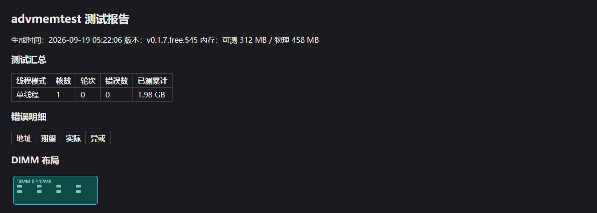


无错误版展示整场统计与 DIMM 布局，适合作为验收存档；错误版在明细表逐条列出错误地址与期望 / 实际值，DIMM 布局同步呈现拓扑，适合随返修件流转——维修方打开报告就知道压测覆盖了多少内存、在哪几个地址上读回不一致。带定位列与布局红标的明细形态属专业版（见第七章），本手册的示例图即含该形态，便于对照（该错误版示例图取自专业版会话，图内版本行即专业版产物；无错误版示例图取自免费版会话）。

### 5.4 查看方式

退出 Shell 后，把报告从**第一个 SFS 卷根（通常 `fs0:`；串口行固定打印 `fs0:`）**的 `advmemtest_report.html` 拷出（或直接从虚拟盘 / U 盘目录访问），用任意现代浏览器打开。报告不依赖本工具即可独立阅读，方便发给厂商或留档。同目录的 `ADVERR.CSV` 可一并拷出，供表格软件或脚本做批量分析。

### 5.5 错误明细 CSV（ADVERR.CSV）

每次报告成功写盘时，同目录（第一个 SFS 卷根）自动写一份 `ADVERR.CSV`。文件名固定为 8.3 短名，方便老式工具与批处理直接读取；固定名覆盖，同一测试系列只留一份。

文件为纯文本，首行固定表头：

```text
address,expected,actual,xor,pattern,class,elapsed_ms,location
```

每行一条错误。`address` / `expected` / `actual` / `xor` 为 `0x` 前缀加 16 位十六进制（共 18 个字符）；`pattern` 为产生该错误的 pattern Id；`class` 为错误类别（0 单元类 / 1 瞬态翻转类 / 2 地址走步类 / 3 缓存驻留类，见 4.1）；`elapsed_ms` 为该错误的已测时刻（毫秒，暂停不计入；0 表示该记录没有可用的时间戳）；`location` 为定位列——**免费版恒为空**，列本身保留，因此表头与专业版一致，消费方不必按 SKU 改列映射。

行数上限与 HTML 错误明细相同：最多 64 条（错误快照上限），总量以报告汇总区为准。**无错误时仍写表头**——明确表示"本次运行没有错误"，也避免上一次运行的文件残留被误读成本次结果。CSV 写盘失败只在串口打 WARN，不改变报告本体已落盘的状态。

## 第六章 高级特性

### 6.1 自我重定位

所有内存测试软件都有一个天然盲区：程序自己占用的内存不在测试范围内——advmemtest 不改变这个前提（工具自身占用不参与测试，与同类工具一致），它做的是把**自管部分的运行状态**变成可观测。启动时它把自身 PE 镜像整体搬移到高端空闲区、按重定位表修正所有绝对地址，并换到一块**固定的 64KB 自管新栈**继续运行——搬移过程在串口输出一行（`relocate: old=... new=... fix=N`，N 为修正条数），此后每次退出都会扫描新栈并给出水位读数（`stack: … used=n/65536`），**栈溢出可见**。**原镜像区保留不释放**（串口另有一行 `old-region-kept: 0x... pages=N`）：该区属固件装载器（DxeCore/Shell）所有——固件在卸载镜像时仍要读它（DEBUG 固件会打印镜像的 PDB 调试信息）并负责回收，工具提前释放，固件就会读到已销毁的内容、回收时又对同一段二次释放，真机上表现为退出时乱码后串口静默/挂死（2026-10-05 真机反馈修复，此前版本有此缺陷）。边界情形：当整机可分配内存低于 4MB 时放弃重定位（设计降级，测试照常）。

### 6.2 SPD 厂商门控

**以下机制属专业版（免费版中这三条为可读不可执行，见第七章）。**厂商专用测试集（三家内存原厂算法）不是无条件启用的：在具备该能力的版本中，软件读取内存的 SPD 信息（真实平台经 SMBus 读取；QEMU 虚拟环境读不到，降级为读取 SMBIOS Type 17 的厂商字段），按 JEDEC 厂商 ID 前缀匹配白名单——**任一已插槽的厂商命中白名单，三条厂商算法就一并进默认集**（union 语义：判定的是"这台机器认得出内存是谁家的"，不是"认出了哪一家"）；匹配失败（包括读不到 SPD、厂商串为空的环境）采取 fail-closed 策略：三条厂商算法**全不选**，仅手动勾选才跑。策略要点是"放行而不是封锁"：原厂算法只在**认得出厂商**的机器上生效（union 语义——任一槽命中白名单即三条一并进入），也避免在完全读不到内存信息的机器上跑无效测试。

免费版中这三条属未授权条目（灰显 + 锁标、不可勾选，见第七章），默认集固定为 13 条经典条目（Id 33 总线应力不在默认集）、不随厂商匹配变化；免费版也不编入 SPD 读取通路——只用 SMBIOS 记录真值，零硬件依赖、零总线风险。槽位基本信息（槽名 / 容量 / 组织 / 颗粒数 / rank）可在 DIMM 带的悬停 tooltip 摘要中查看。

### 6.3 多核模式降级与边界

多核调度的可靠性设计遵循"能降级、不报错"原则：MP 协议缺席、单核平台、运行中拉起 AP 返回不支持的固件，一律自动降级单核并在状态栏注明；**免费版多核参与数上限 16 核**（按 MP 实探核数取较小者，每核缓冲区按实测核数运行时分配，QEMU 下 8 核实测每核约 2.9KB；分配失败 → 单核降级并注明）。降级只影响吞吐，不改变测试语义与错误通道。QEMU 闭环验证覆盖 ≤16 核（8 核实测、单核降级、Pause/Resume 越界修复补证）。

### 6.4 分辨率自适应

启动时软件先探测系统当前显示分辨率（GOP 模式），不足 1280×800（软件界面的设计目标分辨率）时自动请求系统切到更高显示模式——取"宽高都不低于目标、面积不超过 2 倍"的最大一档，避免切到 4K 把图形缓冲撑爆；若系统没有可用模式或切换失败，则保持当前分辨率继续运行（降级），串口与日志都会注明。切换发生在图形界面初始化之前，因此不会出现界面闪烁或尺寸错位。低分辨率降级时窗口内容按比例收缩，极端小分辨率下内容可能超出屏幕——这是降级后的已知边界，建议最小 1024×768。

### 6.5 设置持久化

用户设置（Pattern 勾选、线程模式、轮数上限、无人值守状态汇报周期）在修改确定时自动写入本软件所在目录下的 `ADVMTEST.CFG`（文本格式，一行一个设置；`status.interval=` 为状态汇报周期键、单位秒、见 6.7）。下次启动自动读取：文件存在且内容正确时恢复到上次设置，文件缺失、损坏或卷不支持写入（当前 UEFI 文件协议仅支持 FAT 系卷）时回退到默认值——设置保存失败不影响正常使用，仅在串口以 WARN 提醒。配置文件里属于未授权能力的项（锁定 pattern 位、缓存旁路位、注入位）会被免费版忽略并在串口以 WARN 提醒，不会污染本版行为；**本版新增的平台探针开关 `map.probe` 同理被忽略**——探针与定位数据同属专业版域，免费版没有它们（写 `map.probe=0` 时串口留一行 `[AdvMemTest] map.probe setting ignored (Free build)`；同族参数 `mapprobe` / `-map-mock=` 也各只留一行带前缀的忽略提示）。**免费版的串口里恒不出现以 `map ` 开头的行**——拿免费版跑上述任何参数，找不到专业版手册里那些 `map proto:` / `map probe:` / `map verdict:` 行是设计如此，不是故障；配置文件里游离在能力之外的模式取值（如顺序轮巡 / 轮流）会被**夹回本版缺省档（多线程）**——不是"写死单线程"，而是落到与全新安装一致的缺省值——并在串口输出一行（`thread mode locked (Free): seq/rrobin degraded to default`），状态栏按实际生效的模式显示；若机器无 MP 协议或只有单核，再由此自动降级单线程并在状态栏注明——即"降级而不报错"。

**三档预设（FB-09）**：`ADVMTEST.CFG` 支持一行 `preset=quick|std|burn`，用一个档位名代替逐项勾选——`quick` 取 Free 经典块 15 条（13 经典 + 2 引擎自检参考条，Id 0–14；**不含**新追加的 Id 33–35——Id 33 默认不勾选、Id 34/35 属专业版域）且只跑 1 轮，适合快速筛机；`std` 保持当前勾选的 pattern、只跑 1 轮；`burn` 保持当前勾选、轮数上限 0（连续跑，直到手动停止）。同一入口也可用启动参数临时指定：`advmemtest.efi -preset=quick`（或 `std` / `burn`），**命令行优先于配置文件**；预设先于 `-tests=` 应用，两者同时出现时 `-tests=` 点名的条目集合覆盖预设掩码。生效后串口打一行 `[AdvMemTest] preset: quick (mask=0x7FFF pass=1)`（给出的是生效后的掩码与轮数，不是入参回显）；不认识的取值打 `[AdvMemTest] preset ignored: xxx`（xxx 为原值）后忽略，不改动任何设置；命令行 `-preset=` 取值不认识时只忽略这次覆盖、**回落使用 CFG 的 `preset` 值**（两处都不认识则都不生效）。已识别的预设名会随设置写回 CFG——要退出预设模式，先退出程序、删掉这一行再启动（运行中的设置保存会按当前生效的预设名把该行写回）。

**命令行选择测试条目（`-tests=`）**：启动参数 `advmemtest.efi -tests=<id>[,<id>…]` 用**十进制 Pattern Id**（即 Pattern 对话框每行行首的编号，逗号分隔、不要空格）直接点名本次会话要跑的条目，如 `-tests=0,1,5`；它**覆盖当次会话从 `ADVMTEST.CFG` 读到的 `pattern.mask`**。覆盖只作用于本次运行；生效值随后会随设置保存写回 CFG（`-tests` 生效即触发一次保存，与 `preset` 同一落盘口径），下一次任何设置保存也会继续按生效集合写回——想让下次启动恢复原集合，请在设置里重新勾选或直接改 CFG 里的掩码相关行。本版（免费版）可执行的 Id 为 **0–14 与 33**（14 条勾选面 + 2 条仅供引擎自检、不在勾选对话框显示的参考条）；点名本版不可执行的条目（Pro 专属 Id、超出范围的数字、本机 CPU 不支持的条目）会被**逐条跳过**并在串口留一行 WARN，整条列表都不可用时保持原掩码不变（串口 `cli: -tests matched no executable ids`）；语法非法（如 `-tests=0x3`）的参数**整条作废**（串口 `cli: -tests ignored (bad syntax)`），不采用其中任何 Id，也不影响其他 `-tests=` 参数。生效后串口打一行 `[AdvMemTest] cli: tests mask=0x… (n=…)`，`n=` 是**实际被采纳的 Id 个数**（同一 Id 重复写逐条计入；被忽略的条目不计）。

**测试规模限定（FB-35）**：`ADVMTEST.CFG` 支持一行 `test.limit.pct=<百分比>`（0–100，缺省 0），让一次压测只覆盖可测内存的前若干个百分比——大内存机器做冒烟/筛机时不必等全量跑完。需要特别说明它的口径：这个百分比是**对"实际占到手的可测内存"**计算的，在起测占用完成之后才生效；它**只缩小测试视图**（把各段待测长度按顺序截到累计额度内，越界段不再测试），**占有集本身不变**——测试期间占住的内存与不设限时一样多，停止或退出时仍整份归还，不存在"限额后漏还内存"的副作用。限额按 **4KB 页向下取整**（末尾不足一页的部分不参与测试），因此生效值不会大于所写百分比、且始终停在整页边界上。进度条、报告与 STATUS 心跳里的进度/容量均按限定后的测试视图统计。生效时串口打一行 `[AdvMemTest] test limit: 25% -> 0x... bytes`（给出实际参与且已页对齐的字节数）；键缺失或写 0 时不限额、也不打这一行，行为与旧版逐字一致；写 100 与不限等价，超出 100 按 100 处理。本功能两版都有、语义一致。

**PAR_ROTATE 轮换宽度（FB-40 提速）**：`ADVMTEST.CFG` 支持一行 `par.rotate.cores=<n>`（0–512，缺省 **1**），控制多线程模式下 `PAR_ROTATE`（逐核轮换）条目由多少个核参与轮换。缺省 `1`：每条这类 pattern 只由 1 核跑完整内存——覆盖等价（一条 pattern 由一核完整跑完即可测全），且避免"每核各跑一遍全内存"的 ×N 重复工作量。`2..16` 给出参与核数上限（免费版核数上限 16；超过实际核数按实际核数收窄；AP 拉起失败降级单核时同样按最终核数收窄）。`0` = 旧版全核各自全量（最慢，仅用于需要每核都走一遍的压测）。键只影响**多线程模式下的 PAR_ROTATE 条目**；顺序轮巡 / 轮流 / 单线程的逐核语义不变。起测串口的 `perf:` 行会给出实际参与轮换的核数（`rotate on K core(s)`，见 3.4）；串口 `cfg par.rotate.cores: has=… val=…` 是解析回执（`has=0` 表示键缺失、引擎用缺省 1）。设置对话框不提供入口；键随全量保存回写（未手写则保存为 1）。本功能两版都有、语义一致。

**出错告警（FB-32）**：`ADVMTEST.CFG` 支持两行出错告警设置，二者互相独立、可只开其一（两键均只经配置文件设置，设置对话框不提供入口）。`beep.on.error=1` 打开**首错蜂鸣**（0/1，缺省 0）：一次测试系列（从起测到停止）中**第一个**错误被捕获时蜂鸣一次（约 1000 Hz、120 毫秒），同一系列此后不再响——**每系列只响一次**，重新起测后再次生效；蜂鸣前串口先打一行 `[AdvMemTest] beep: freq=1000 ms=120`，机器没有蜂鸣器时以这行作为"确实触发过"的证据。`stop.after.errors=<次数>` 打开**出错 N 次自动停止**（0–9999，缺省 0 = 关）：累计错误数达到 N 时自动停止测试，走与菜单"停止测试"完全相同的入口——状态栏显示停止态，并**照常自动写出 HTML 报告**（错误明细等既有内容一并落盘），不会因为"不是人按的停止"而少写任何东西；串口打一行 `[AdvMemTest] stop: error limit reached (errors=… limit=…)`。判据是**累计错误数**（与 STATUS 心跳里的 `errs` 同一口径），不是错误率。本功能两版都有、语义一致。

### 6.6 内存带宽曲线

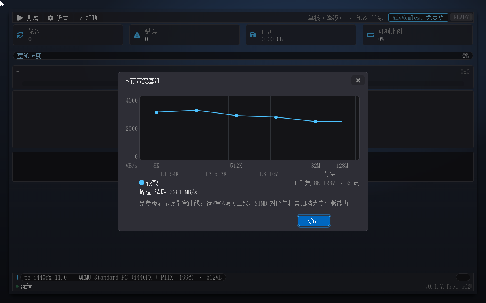

"测试 → 内存带宽基准..."打开的是**一条工作集扫描曲线**，而不是单值读数：程序独立申请内存块，按从小到大的工作集逐档跑读写、算出每档的带宽（MB/s），横轴按工作集大小对数展开——于是缓存层级在图上自己显形：工作集小于一级缓存时数据全在 L1，带宽最高；涨过 L1、L2、L3 的容量后逐档下台阶；最后落到内存本身。图上因此标出 **L1 / L2 / L3 / 内存** 四档台阶竖线，台阶尺寸取自 CPUID 报告的真实缓存大小；取不到时以 `~` 前缀标出（如 `L1 ~32K`）——**推测值绝不当事实呈现**，这与器件位宽标的"（推测）"是同一条纪律。图例行给出峰值与工作集范围（如"工作集 8K-128M · 6 点"）。

免费版画**读取**一条线（外加一行说明："免费版显示读带宽曲线；读/写/拷贝三线、SIMD 对照与报告归档为专业版能力"）。基准与测试运行态解耦：独立申请、算完归还，测试跑着也能打开（打开时主循环会短暂让一拍）。内存紧张时块会逐级缩小、点数变少，此时工作集范围行会如实显示缩小的末档——这是自适应降级，不是失败。

在专业版里，一次基准的结果会随**下一次**报告落盘（报告"带宽曲线"段），因此想让它进报告就先跑一次基准再停止测试；**免费版的报告不含这一段**（报告三段的完整口径见 5.2）。**数值不承诺**：单位口径为整数、十进制 M（各遍取最大值，单遍计量窗不低于 10 ms）；曲线反映的是当前环境（含虚拟化）的综合带宽，不是 DRAM 时序标称值——**跨机只看同一环境下的相对量级，请勿与其它工具或历史报告直接比对**（报告里也印着这句同源提醒）。

### 6.7 无人值守与 BMC 集成：STATUS 心跳

长时间无人值守压测（机房挂机、自动化流水线、BMC 串口捕获）需要一个"程序还活着、现在跑到哪"的低成本证据，advmemtest 为此提供 **STATUS 心跳**（**默认开启、缺省 1 分钟一行**）：开启后，程序在图形界面就绪之后的整个生命周期里（**空闲、测试中、暂停中都发**——"应用活着"本身就是事实，当前状态由 `state` 字段区分）每 `status.interval` 秒往串口打**恰好一行** ASCII 状态行，BMC 的 SOL（串口重定向）或自动化脚本按行抓取即可：

```
STATUS seq=42 state=run pass=1 pct=37 test=7 addr=0x1a2b3000 errs=0 elapsed=1:37:12 temp=- peak=-
```

字段依次是：自增序号 `seq`（从 1 起，脚本据此判"行在推进"）、状态 `state`（`idle` 空闲 / `run` 运行中 / `pause` 暂停）、已完成轮次 `pass`、进度百分比 `pct`（与主界面那条大进度条同源；设了轮数上限时是含已完成轮次的总进度）、当前 pattern 的 Id `test`（空闲/未起测时该字段是引擎内部的"未定"哨兵值 `4294967295`，起测后落到真实 Id）、当前测试地址 `addr`（十六进制，字母大写）、累计错误数 `errs`、已测时长 `elapsed`（`时:分:秒`，暂停期间不计入）、内存温度与峰值温度 `temp` / `peak`。**免费版不读取 SPD，`temp` 与 `peak` 恒为 `-`**（`-` 表示"无读数"而不是 0 度；专业版读出真实读数时按"摄氏度 + 一位小数"呈现）。**无论测试是否发现错误，均按 `status.interval` 持续汇报；连续三个周期无行判死（给固件时钟偏差留一个周期余量；上位机指南同此口径）。**

开启方式有两种，落盘的都是同一项设置：在"设置 → 测试配置..."里勾选**"无人值守状态汇报"**并调整间隔（界面以**分钟**为单位，1–60 分钟），或直接在 `ADVMTEST.CFG` 里写一行 `status.interval=<秒>`（取值范围 1–3600，超过按 3600 处理）。**界面上以分钟为单位，配置文件里以秒为单位**——自动化/BMC 预置请用配置文件那个口径（写 `status.interval=5` 就是 5 秒一行；界面回读时 5 秒会显示为 1 分钟，但只要你不去动那一行，确定后配置文件里的秒值原样保留，不会被改写成 60）。**默认开启**：键缺失时按**缺省 1 分钟**（60 秒）汇报，开箱即得 BMC 存活行；要回到"稳态零输出"，在设置里取消勾选或写 `status.interval=0`（显式关档）即可——此后串口上除测试失败行与既有遥测外不会有任何周期性输出。

两条使用提示：① 判活用"连续三个周期缺行"而不是"一行都没等到"——程序启动、占用内存等阶段的耗时与机器相关（占用阶段主循环不转、没有心跳，属正常）；② 间隔由程序内部毫秒时钟计时，个别固件的时钟偏差可能使实际间隔略长于设定值，三个周期已含一个周期的余量，不要再缩短。系列结束时的机器可读终局行见 6.8。

### 6.8 机器可读终局行 RESULT（两版都有）

每个测试系列结束时（达标完成、手动停止或错误阈值停止），Free 版也会在报告写盘之后向串口发射**恰好一行** `RESULT` 终局行。运行中直接从“帮助 → 退出”结束程序不经过停止转换点，不会补发 `RESULT`。

```
[AdvMemTest] RESULT: verdict=<PASS|FAIL|STOPPED> errors=<n> passes=<n> elapsed=<seconds> mask=0x<hex> reason=<complete|stop>
```

字段依次是：判定 `verdict`（有错即 `FAIL`；**ECC 会话判定为 `FAIL` 也是 `FAIL`，即使 `errors=0`，见 6.9**；无错且达标为 `PASS`；无错但未达标为 `STOPPED`）、累计内存测试错误数 `errors`（**不含** ECC 判定——ECC 判 `FAIL` 时可能为 0）、已完成整轮数 `passes`、引擎秒表整秒 `elapsed`（暂停不计入、停止后冻结）、实际生效的 Pattern 掩码 `mask`（十六进制、字母大写）、停因 `reason`（`complete` = 达到轮数上限自停；`stop` = 其余停止）。判读口径：`PASS + complete` 才算跑满且零错；`STOPPED + stop` 只表示**没跑完**，不等于内存通过；连续模式（`pass.limit=0`）永远不会出现 `complete`。构建 627 实样（Free，达标完成）：

```
[AdvMemTest] RESULT: verdict=PASS errors=0 passes=1 elapsed=0 mask=0x1 reason=complete
```

上位机可以只靠 `STATUS` 心跳与这一行完成无人值守采集；Free 版没有串口触发起测与 `finish.action` 完成动作（这两项是 Pro 能力，见 7.1），起测请用倒计时自动开始或菜单。完整的行契约与 BMC SOL 接入方式见 `docs/advmemtest-host-sync-guide.md`。

### 6.9 ECC 会话判定（免费版：仅串口）

免费版与专业版共用同一条 ECC 会话判定链：起测时取 MCA bank 基线，停止时再取一次并逐 bank 差分，只有基线之后新增的记录才计入本会话。判定结果打一行 ASCII 串口行，每个测试系列**恰好一行**（在报告写盘与 `RESULT` 之前；运行中退出、需补写错误报告且本系列起测基线可用时也会先判定一次；未起测的空闲"停止"不会产生此行）：

```
[AdvMemTest] ECC: verdict=PASS|FAIL|UNKNOWN ue_new=N ce_new=N valid=0|1
```

字段与判定规则：`ue_new` / `ce_new` 是新增的 CE / UE **bank 数**，**不是错误次数**（MCA 每个 bank 只保留最近一条记录）；`valid=0` 表示无可比基线（AMD 平台、无 MCA 能力的固件，或 QEMU 默认的 qemu64 核型——AMD 厂商串、没有 MCA 通路；QEMU 显式设为 Intel 核型时能读到 bank 数据）。无可比基线，或任一侧有 bank 读不到（`FaultCount>0`）⇒ `UNKNOWN`；新增 UE（免费版固定按缺省策略）或新增 CE bank 数达到阈值 ⇒ `FAIL`；其余 `PASS`。ECC 判 `FAIL` 时 `RESULT` 的 `verdict` 也是 `FAIL`——**即使 `errors=0`**；`UNKNOWN` 不影响 `RESULT`。完整口径（基线差分、粘滞记录、盲区为何不判）见专业版手册 8.5。

免费版有两处差异。**报告里没有 ECC 段**：免费版报告的归档三段（带宽曲线、温度、ECC）整段不编入，所以会话新增/判定只体现在串口行与 `RESULT` 上——`advmemtest_report.html` 里既没有 ECC 段，也没有"会话新增/ECC 判定"行。**`ecc.ue.fail` / `ecc.ce.threshold` 两键不被消费**：免费版固定按缺省策略执行（新增 UE ⇒ `FAIL`、CE 不单独触发）；配置里写了会改变行为的非缺省值（`ecc.ue.fail=0`、`ecc.ce.threshold` 非 0）时，串口留一行 `ecc.ue.fail setting ignored (Free build)` 或 `ecc.ce.threshold setting ignored (Free build)` 后照缺省策略执行；只写缺省值（`ecc.ue.fail=1`、`ecc.ce.threshold=0`）不会提示。

**免费版不采集 ECC 地址与 `MCi_MISC`**：不读 `MCi_ADDR`/`MCi_MISC`、不输出 `ECC_LOC:` 定位行，也不输出带 `misc=` 的 Pro 诊断行（免费版镜像不含该 token）；运行中的 bank 行维持 addr-only 形态，且无地址源时恒为 `addr=-`。报告里没有 ECC 段，自然也没有地址/位置/`Misc` 这些列。PRO 版的逐 bank 地址定位与 `misc` 诊断口径见专业版手册 8.4 与 8.5。

边界：QEMU 默认的 qemu64 核型（AMD 厂商串）没有 MCA 通路，只能得到 `UNKNOWN`（不拖红 `RESULT`）；QEMU 的 Intel 核型（如 Skylake-Client，实测 `banks=10`）可得到 `valid=1`，能验证"有通路、零新增 ⇒ `PASS`"，但同样不产生真实的新增 CE/UE 记录。真实 CE/UE 的 `FAIL` 判定与"bank 读不到"的盲区分支需要板级或故障注入环境才有阳性证据。

## 第七章 升级到专业版

免费版覆盖经典测试集；当工作内容跨过"这台机器能不能用"进入"哪根条、哪颗芯片坏了、要不要向厂商索赔"，专业版把测试面与证据链都再推一层：**测试面铺到工程显影级**（时序窗口、地弹、原厂算法深度搜索），**错误指认精确到芯片**，**坏页清单可直接交给操作系统屏蔽**。

### 7.1 专业版能力速览

**以下能力均为专业版专属；免费版镜像不编入对应实现——坏块清单导出（含实验性生长档 A/B 对照）与内存设置 / SPD 深度页都不在免费版产物内。**

- **颗粒级错误定位**——错误地址换算为 Socket / Channel / DIMM / Rank / Device 五级坐标，界面错误日志、串口 TEST_FAIL 行与 HTML 报告三处口径一致；DIMM 带与报告的出错槽位红边、出错颗粒红点同步"指认"故障芯片，定位粒度对标 Memtest86 Pro 的 Site（颗粒/位）级。器件位宽的精度三级（真值 / 推测 / 未知）与"近似映射 / 平台映射"两级口径同时外显，推测值绝不当事实呈现。
- **36 条 pattern 全量可执行**——在免费版 14 条可勾选条目之上，增加 Advanced 系工程序列（MATS8 三相位变体、XMATS8/16、WCMATS8/WCMCH8、GNDB64、MARCHCM64、TWR、DATA_RET、SCRAM_X2）、三家内存原厂专用算法（受 SPD 厂商门控，匹配才进默认集、任何时候可手动放行）、两条域宽增补条（32/64 位档走滑，默认不勾选）、**Adv 缓存驻留压力**（Id 34，小工作集驻留缓存层的写读翻转，默认不勾选）、**Adv BG 条纹扫描**（Id 35，256KB 窗口内按 4KB stripe 步进跨页写读，用软件地址流模拟 bank-group 交织压力；不是 DRAM 单元保持力测试，错误类别 `TRANSIENT`、不进坏块清单；默认不勾选），以及 SIMD-256 宽访存（AVX2 单指令 32 字节；**需 CPU 与固件启用 AVX2**——多数 edk2 系固件（含 OVMF）不置 CR4.OSXSAVE/XCR0，该条在多数机器上**自动锁定**、只是不参与测试，不影响其它任何条目）。Pattern 对话框中全部 34 行列出，无 Pro 锁标；无 AVX2 的机器上 SIMD-256 一行按能力灰显锁定（实跑 35 条），提示语为"本机 CPU/固件不支持 AVX2 宽访存"。
- **两档额外调度**——顺序轮巡（每条 pattern 由全部核轮流各跑一遍全量，适合逐核核验与对照诊断）与轮流（以 (pattern, 核) 为最小单元全局轮转，适合控制变量式的分核诊断）。
- **SPD 深度信息页**——全屏 SPD 解码页：平台判定 / 通路 / 数据源三枚状态徽章 + 槽位档案（基础信息 / 厂商与标识 / CRC 对账三态）+ **内存设置**（SMBIOS 实况速度/电压、SPD 标称时序、XMP 3.0 profile1、EXPO 仅存在性；IMC 实况时序明示"不可用（平台未提供）"；无 SPD 数据时该节不存在）+ **温度明细**（逐模组当前/峰值）+ **ECC 明细**（逐 bank 的 CE/UE 计数），六后端（I3C-CSR / BDAT / SPD5-I3C / ZX-I2C / SMBus / Null 保底）按平台逐级探测、先到先得；无通路时呈现一等公民的 SMBIOS 摘要降级态（温度与 ECC 两节随之整节省略）。
- **内存带宽曲线**——工作集扫描曲线取代单值三卡：读 / 写 / 拷贝三条线 + 一条 SIMD 对照线，横轴按工作集大小对数展开，并标注 L1 / L2 / L3 / 内存四档缓存台阶（台阶尺寸取 CPUID 真值；取不到时以 `~` 前缀标出非真值）；独占独立块自取自还，与测试运行态解耦；报告侧落"带宽曲线"段（4 条折线 + 逐点表）。
- **禁用缓存测试模式**——置 CR0.CD 缓存旁路并广播至各 AP，避免缓存把抖动与单元故障"盖住"，直击读回校验的存储阵列真值。
- **坏块清单导出**——随报告同点写出 `badram.txt`（BadRAM 格式 `badram=F,M`，页粒度、2 的幂次合并）与 `badmemorylist.txt`（Windows BCD `bcdedit /set {badmemory}` 命令，扁平 PFN 列表），把"哪些页别再用"变成一条命令；只收 `cls=0` 单元类错误，瞬态翻转（`cls=1`，行锤/总线应力）、地址走步（`cls=2`）与缓存驻留（`cls=3`）不进清单。专业版另写一份**实验性生长档 A/B 对照产物**（同一页集、另一种合并算法；可能过度覆盖健康页，**仅供对照，勿直接用于内核屏蔽**），报告内给出严格/生长两档的 A/B 摘要，串口对应一行 `badram ab:`；**工具不自动择优**，严格档仍是唯一推荐交给系统的产物。
- **多核上限 512 核**——按 MP 实探核数取 min(探测, 512)，每核邮箱与错误缓冲按实测核数运行时分配（512 核约 1.5MB 级）。
- **上位机串口同步**——Pro 支持 `serial.start` / `serial.start.key` 串口触发起测，以及 `finish.action=reboot|poweroff` 达标完成动作；Free 只输出 `STATUS` 心跳与 `RESULT` 终局行（两版同格式），起测走倒计时或菜单。完整契约见 `docs/advmemtest-host-sync-guide.md`。
- **PXE 网络启动与站点授权**——专业版可作为 UEFI PXE 的启动镜像，启动后经固件保留的 PXE Base Code 通道，从同一台 PXE 服务器的 TFTP 根取回站点授权 `site.lic`（可选只读配置 `site.cfg`），离线验签后运行；服务器侧不需要授权服务或 TLS，续期只替换 TFTP 根上的证，适合无盘机房批量部署。**免费版可以被 PXE 启动，但镜像不含网络取件代码**：不消费 `site.lic` / `site.cfg`，串口也没有 `LICENSE: pxe:` 行——需要站点授权下发的部署请使用专业版（完整说明见专业版手册 7.4 与《PXE 部署指南》）。
- **授权安装**——专业版须持有随证交付的授权文件方可启动（RSA-2048 离线验签、无需联网、无需注册）；安装细节随证说明，无授权文件时专业版会拒绝启动并给出原因。

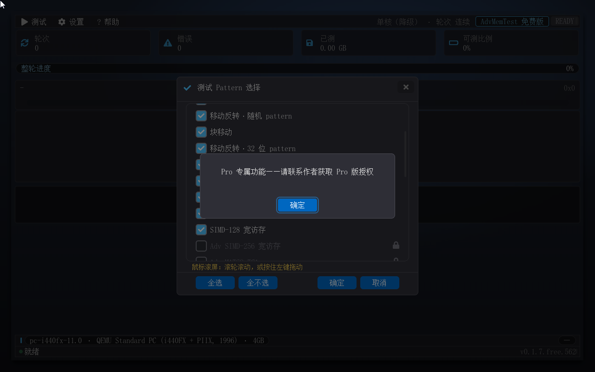

上图是免费版里"可读不可执行"的形态：条目内容可读、焦点圈可落，勾选框灰显 + 锁标，按下回车即弹出获取途径的提示（完整画面见 3.3 的 Pattern 选择对话框与 3.4 的线程模式对话框）。这条机制在免费版中同样诚实——不会"算出来再藏起来"，而是明确标出能力边界。

设置菜单里的"体验功能…""内存信息…"两项，以及测试配置底部的"禁用缓存测试模式（Pro）"说明行，也是同一套导流形态：免费版把它们**原样列出但锁上**，而不是藏起来让人猜。两者的交互形态不同，需要分清：设置菜单的两项是**可聚焦、可点击**的锁定入口，回车或点击会弹出获取途径提示（与 Pattern 对话框的锁定行同一套提示）；测试配置底部的缓存说明行则是**纯文字锁定注记**——没有复选框、不挂任何回调、也不进焦点圈，只是把"这一档属于 Pro"如实标出。这三处导流项在免费版产物里都没有对应的实现代码——发布门禁会用链接 map 做边界检查（Free 产物不得出现 Pro 的对话框与缓存旁路实现符号），确保"锁标"不是一层贴纸。

### 7.2 授权条款与获取途径

免费版供个人用户免费使用；商业用途（营利性部署 / 分发 / 预装）需取得专业版授权。**获取途径：请联系作者**（升级咨询、批量授权、按需报价与试用证一并受理）。

## 第八章 常见问题

**为什么"可测比例"不是 100%？** 因为固件头部预留了 128MB 不纳入测试，加上固件自身占用的区域，可测内存与物理内存存在固定差值。这是 UEFI 应用的根本约束——被测内存必须向固件申请，测完归还；工具自己占用的内存（重定位后的新镜像区，以及保留在固件装载器名下的原镜像区）同样不参与测试。可测比例在测试中不变化，真实比例以实测为准。

**报告在哪个位置？** 通常是 `fs0:\advmemtest_report.html`——程序写固件枚举到的**第一个 SFS 卷根**（通常是 `fs0:`，不扫描可写卷）；串口 `report written to fs0:\advmemtest_report.html` 是固定文案，不代表实际卷号。停止测试与达标完成时自动写入；退出时仅在本次系列已有错误且尚未写过报告时补写，同系列固定名覆盖。找不到时先确认 Shell 当前盘是 fs0:，再用 `ls fs0:` 查看。

**免费版能从 PXE 启动吗？** 能。把免费版 efi 作为 PXE 启动镜像（如 `BOOTX64.EFI`）放进 TFTP 根，客户机从网络启动即可进入图形界面。但免费版镜像**不含网络取件代码**：它不读 `site.lic`、不读 `site.cfg`，串口也没有 `LICENSE: pxe:` 行——免费版本来就不需要授权。若你的部署要靠 PXE 统一下发站点授权与只读配置，请使用专业版（见第七章与专业版手册 7.4）。

**测试大概要跑多久？** 取决于内存容量、pattern 条数与核数。粗估公式：单核全量一轮 ≈ 内存容量 ÷ 吞吐（不同 pattern 差异很大，Bit fade 这类静置型 pattern 单条时长显著拉长）；多核切分并发按约 2.5×（4 核实测）折算。精确时长以实测为准——这也是为什么建议先跑一轮小容量 / 少 pattern 的组合做时间预算。

**免费版能做什么，多出来的能力是什么？** 免费版可勾选（用户可见）14 条测试条目（默认勾选其中 13 条，Id 33 总线应力默认不勾选；另 2 条引擎自检参考条不对外展示），支持单线程 / 多线程两档调度与自我重定位，报告与串口口径为地址级；专业版在其上增加颗粒级定位、36 条 pattern 全量、SPD 深度页、带宽曲线、禁用缓存、坏块清单导出与 512 核扩展。详见第七章。

**错误注入演示在免费版里有吗？** **入口可见，功能不在本版**——设置菜单里有"体验功能…"一行，但它是 Pro 锁定导流项（灰显 + 锁标），点击只弹出获取途径提示；注入演示（故意翻转一位以演练完整错误上报链路）的实现不编入免费版镜像。同类锁定导流项还有"内存信息…"（SPD 深度页）与测试配置底部的"禁用缓存测试模式（Pro）"说明行。能力边界与获取途径见第七章。

**16 核以上的平台只用了一部分核？** 免费版按 16 核封顶参与调度，多余核心不参与。降级不影响正确性，只影响吞吐。

**按了 Esc 测试停止了，岂不是白跑了？** 不会：运行中按 Esc 只是**暂停**——进度、错误现场全保，再按一次 Esc 即从原地址继续。只有主动点"测试 → 停止测试"才会真正结束测试系列并写报告，所以不需要担心误触白跑。

**我还没动手，测试自己开始了？** 是"倒计时自动开始测试"（对标 Memtest86 的缺省行为，免得机器停在界面上"看着像跑着"，见 3.5）：主界面就绪后 10 秒无操作即自动起测，状态栏会逐秒提示 `将在 N 秒后自动开始测试（按任意键取消）`。不想要它：倒计时期间按任意键或移动鼠标即取消（本会话不再自动起测）；要永久关掉或改时长，去"设置 → 测试配置"（3–120 秒，勾选/取消勾选保存后**下次启动生效**——本会话的倒计时在启动时已经定下，且你打开对话框这个动作本身就已把它取消了）。

## 附录 A 对话框速查

| 对话框 | 打开方式 | 一句话说明 |
|---|---|---|
| 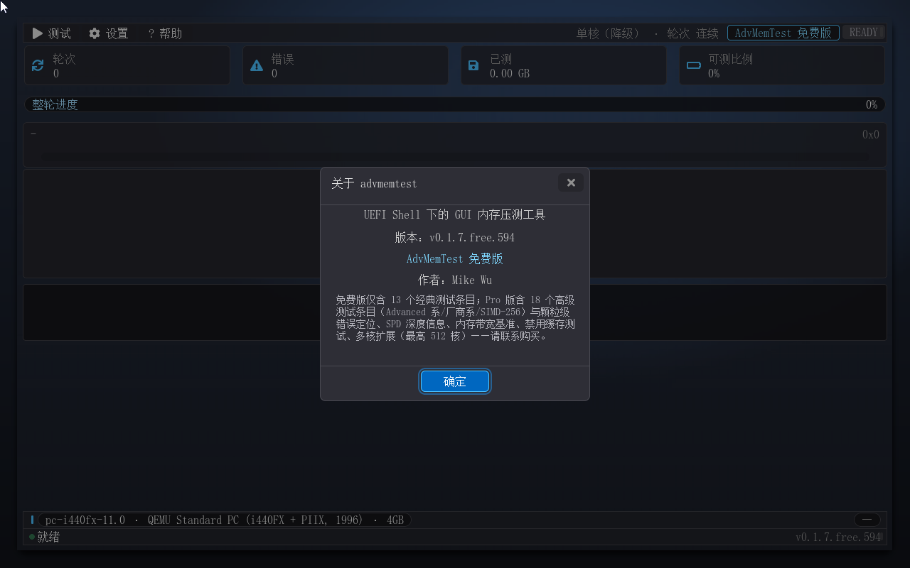 | 帮助菜单 / F1 | 版本、构建号、版权信息与升级导流段 |
| 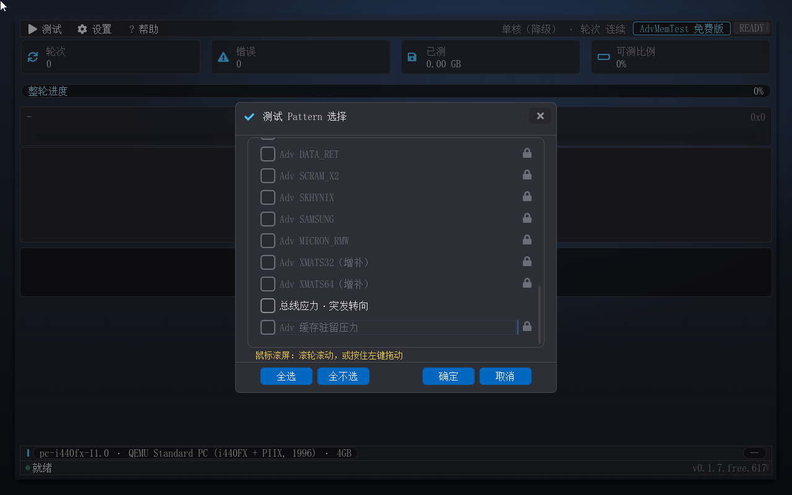 | 设置 → 测试 Pattern 选择... | 34 条用户可见 pattern 按 Id 顺序勾选，默认集 13 条（14 条可勾选，Id 33 默认不勾选）；20 条未授权条目灰显 + 锁标 + 提示 |
|  | 设置 → 线程模式... | 单线程 / 多线程两档可选；未授权的两档灰显 + 锁标 + 提示 |
|  | 设置 → 测试配置... | 轮数上限 1–99 或连续运行；倒计时自动开始测试（默认开、缺省 10 秒、可调 3–120）；含"无人值守状态汇报"复选框 + 分钟档（见 6.7）；底部"禁用缓存测试模式（Pro）"为锁定说明行（无控件） |
|  | 测试 → 内存带宽基准... | 工作集扫描读带宽曲线 + L1/L2/L3/内存四档缓存台阶标注 |
|  | 空闲时按 Esc，或 帮助 → 退出 | 确认退出；Esc 在运行中是暂停/继续、不弹确认框，"帮助 → 退出"任何时候（含运行中）都直达确认框；停止测试走菜单"停止测试" |

所有对话框打开时 Tab 焦点锁定在对话框内循环，Esc 按"消息框 → 对话框 → 主窗口"顺序逐级关闭。

## 附录 B 版本与发布信息

- **当前版本**：0.1.7（免费版）。构建号随每次构建递增，`APP_VERSION=v<版本>.<sku>.<构建号>`（如 v0.1.7.free.562）输出于界面固定角落与串口，可与构建记录核对。
- **发布物**：`AdvMemTestFree.efi`（单文件，无外部依赖、无授权文件要求）、**可直接启动的 ISO**（`advmemtest-free.iso`，刻 U 盘 / 挂 BMC 虚拟光驱即用，不需要先有 UEFI Shell；使用前请先关闭 Secure Boot）、本手册（`user-guide-free.md`）与简版 `quick-guide.md`、报告样例截图。
- **ISO 路径的三条实测口径**：① 介质只读时**报告仍能落盘**——程序写到固件枚举到的**第一个 SFS 卷根**（通常是 `fs0:`；**不扫描可写卷**。Ventoy 实测为 VTOYEFI 分区根，dd 直写为盘内 ESP 空簇；串口 `report written to fs0:\...` 的卷号是固定文案，不代表实际卷号）；**只有设置（`ADVMTEST.CFG`）恒存不下来**（要么卷只读、要么连程序目录都定位不到），需长挂设置请按 1.2 的表选可写 FAT32 盘跑；若整机没有可写卷，串口会打一行 `WARN: report write failed: Write Protected`，程序不崩、测试不中断；② 程序"退出"后回到固件引导流程（QEMU/OVMF 实测落在启动设备选择菜单，未自动重引导本盘；若该盘在启动顺序里仍列首位则可能重新引导），离开测试请断电、改启动顺序或拔盘；③ 只读盘上设置（`ADVMTEST.CFG`）同样存不下来，当次运行照常。
- **已知边界（以实测为准）**：**器件位宽只有 SPD 能提供，免费版不读取 SPD，一律按 x8 推测并在界面 tooltip 强制标注"（推测）"**（位宽未知时不印位宽与颗粒数）；QEMU 虚拟环境读不到真实 SPD，厂商门控不参与免费版默认集；**免费版没有温度读数**（不编 SPD 栈，温度源由构造不存在——"内存健康"卡在免费版只可能显示 ECC 一面，见 2.2）；多核上限 16 核；自我重定位在可分配内存低于 4MB 时放弃；分辨率降级后极端小屏可能超出屏幕。**能力边界按"对话框 / 报告"两层分**：**内存带宽基准对话框两版都有**（免费版只画读取一条线），但**报告的"带宽曲线"归档段是专业版能力**——免费版跑完基准不出报告段；颗粒级定位、坏块清单导出（含实验性生长档 A/B 对照）、SPD 深度页与内存设置节、温度/ECC 报告段、禁用缓存等能力不在本版内（见第七章）。
- **固件时钟口径**：底部平台信息条右端的"**起测**"时刻（条上就带这个标签）取**固件墙钟**（`GetTime`），UEFI 规范不规定其时区语义——可能与你的墙上时钟相差整数小时，属预期行为而非缺陷（见 2.5）。
