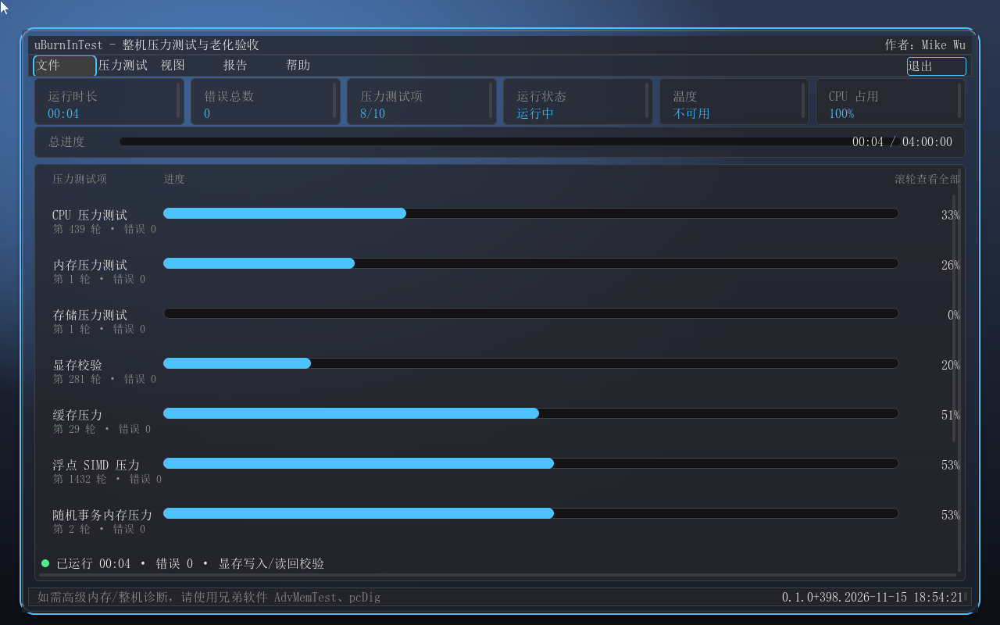
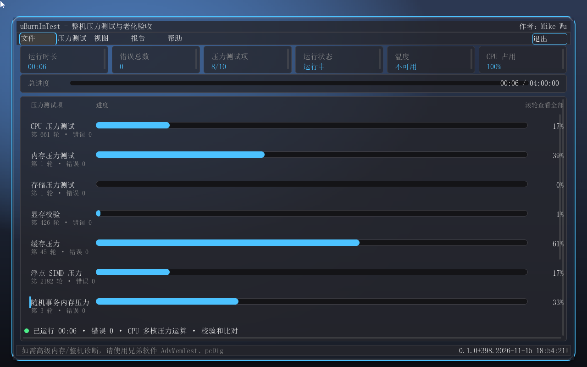
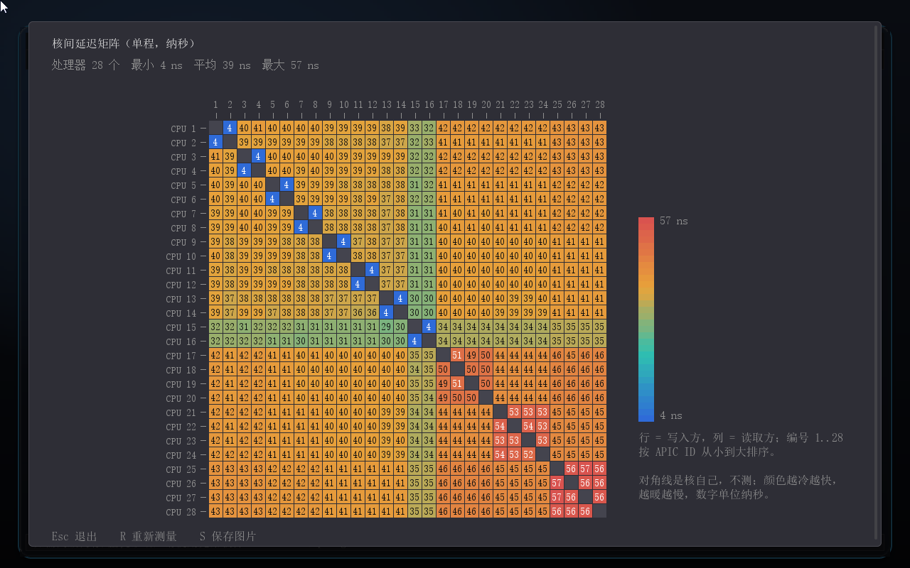

# uBurnInTest — 整机老化与验收工具（二进制发布包）

> [English version below](#english) ｜ [English README](#english)

uBurnInTest 跑在 **UEFI Shell** 里，在操作系统启动之前工作：把一台机器交给它跑几个小时，事后读一份可校验的判定报告。它面向产线老化架与来料验机——机箱还没装系统、驱动栈还没起来的时候，测到的是"这台机器本身"，而不是"OS 接管之后的样子"。

**整机，不是单点**：十个压力项同时压 CPU、内存、存储、显存、缓存、SIMD、随机事务内存、磁盘随机寻道、PCIe 链路与多核同步；每一项都**写进去、再读回来、逐字节比对**，所以错误是被**发现**的，不是被制造出来的。开机默认待命，操作员按空格才开始；也可以把测试时长、轮次和模块开关写进 `UBIT_CFG.TXT` 做无人值守。跑完落盘文本报告、HTML 报告、可打印测试证书，还能导出基线快照与多机批量汇总。

- **版本**：0.1.0（Build 424，2026-11-19）
- **发布**：tag **`uBurnInTest-v0.1.0.424`**
- **作者**：Mike Wu（mikewuping@163.com）
- **许可**：**个人用户免费使用**；商业用途（随产品分发、产线交付、集成进别的方案）需事先联系作者书面授权。**本软件不是开源软件，源码不在本仓库发布**——见[许可](#许可)节
- **产品手册**：[中文 Markdown](docs/manual/uBurnInTest-产品手册.md) ｜ [HTML](docs/manual/uBurnInTest-产品手册.html) ｜ [Word](docs/manual/uBurnInTest-产品手册.docx) ｜ [功能演示 GIF](docs/manual/uBurnInTest-演示.gif) —— 35 张界面截图与逐步说明

## 包内容

| 文件 | 说明 |
|---|---|
| `binaries/uBurnInTest.efi` | 应用本体（UEFI x64 应用，约 2.3 MB）——无需授权文件，个人用户免费使用 |
| `docs/manual/` | 产品手册（MD / HTML / Word 三种格式）、35 张界面截图、功能演示 GIF |
| `uBurnInTest-0.1.0.424+20261119_140827.zip` | 便捷包（程序 + 手册 + 截图与演示动图——与 Release 资产同内容） |

本仓库**只发布二进制与文档，不含任何源码**。

## 快速上手

1. 把 `binaries/uBurnInTest.efi` 复制到 FAT32 启动盘（连同 `startup.nsh` 可开机自启），进 UEFI Shell 执行文件名。
2. **先关 Secure Boot**：本程序没有代码签名，开着 Secure Boot 的固件不会放行。
3. 主界面按 `空格` 或 `Enter` 开始；运行中 `空格` / `Esc` 暂停与继续，跑满时长后自动出报告。
4. 报告、证书、基线写在同一启动盘根目录（`UBIT_RPT.TXT` / `UBIT_RPT.HTM` / `UBITCERT.TXT` / `UBITBASE.TXT`）；矩阵页按 `S` 存 `UBIT_LAT.BMP`。
5. 无人值守：把 `UBIT_CFG.TXT` 放在启动盘根目录，配置时长、轮次、占空比和各模块开关，开机自动跑。

*运行页：十个模块的实时状态、整机占用率与心跳，报告和证书导出也在同一屏操作*

## 能测什么

| 类别 | 内容 |
|---|---|
| 十个压力模块 | CPU 算术、多种 pattern 内存、存储写读比对、显存校验、缓存驻留、SIMD 浮点、随机事务内存、磁盘随机寻道、PCIe 链路重训练、多核同步 |
| 交叉校验 | 多核路径用独立 reference 比对结果，不是"跑起来就算" |
| 视图 | 运行进度、硬件状态、统计卡、坏点色卡、**核间延迟矩阵**（N×N 热力图，格内写纳秒数） |
| 产物 | 文本报告、HTML 报告、可打印证书、基线快照、多机批量汇总 CSV/HTML |
| 配置 | 图形化设置对话框 + `UBIT_CFG.TXT` 无人值守与多轮循环 |

*核间延迟：28 核真机数据，格内直接读单程纳秒数。这张图不是"距离图"——共享 L2 的核反而更慢，详见手册*

## 平台与运行要求

| 项目 | 要求 |
|---|---|
| 平台 | x86-64（X64）UEFI 固件，无操作系统要求；不支持 Legacy / CSM |
| Secure Boot | **必须关闭**——本程序未做代码签名 |
| 介质 | FAT32 可写卷（报告与配置落盘用）；从只读介质启动不影响运行，但导不出报告 |
| 屏幕 | 图形控制台（GOP），1280×800 或更高 |
| 输入 | 鼠标与键盘均可；`Tab` 焦点环 + `Esc` 逐层返回，全流程可不用鼠标 |

## 变更记录

- **2026-11-19 · uBurnInTest-v0.1.0.424**：二进制发布首版。整机十个压力模块、六类视图（含核间延迟矩阵）、报告与证书、基线与批量汇总、无人值守配置；矩阵改为 1..N 序号坐标轴与格内纳秒数，手册同步更新。个人用户免费；源码不公开。

## 姊妹工具

本套件其它成员：pcDig（整机硬件诊断）、BootDoctor（启动诊断修复）、AdvMemTest（内存压力测试）、UefiEraser（磁盘数据粉碎）、uwinunlocker（离线重置 Windows 本地账户密码）、AdvDiskTest（硬盘检测）。运行环境与 GUI 底座同为 LVGL 的 UEFI 移植。

## 许可

本软件**不是开源软件**，仓库内不含源码。**个人用户免费使用**（自用、学习研究、评估选型，不用付费也不用申请）；**商业用途**——随产品分发、产线交付、集成进其它方案等——需事先联系作者取得书面授权：mikewuping@163.com。第三方组件 LVGL 的 UEFI 移植层遵循其自身许可。

---

## English

# uBurnInTest — Whole-Machine Burn-in & Acceptance Tool (Binary Release)

uBurnInTest runs in the **UEFI Shell**, before any operating system boots. Hand it a machine for a few hours and read a verifiable verdict afterwards. It is built for production-line burn-in racks and incoming inspection: before an OS is installed and before the driver stack exists, what you measure is **the machine itself**, not the machine after an OS has taken over.

**Whole machine, not one point**: ten stress items hammer the CPU, memory, storage, frame buffer, caches, SIMD, random-transaction memory, random disk seeking, the PCIe link and multi-core synchronisation at once. Every item **writes data, reads it back and compares it byte for byte** — errors are *found*, not manufactured. The machine idles at boot until the operator presses `Space`; unattended runs can be configured through `UBIT_CFG.TXT`. At the end you get a text report, an HTML report, a printable certificate, a baseline snapshot and a multi-machine summary.

- **Version**: 0.1.0 (Build 424, 2026-11-19)
- **Release**: tag **`uBurnInTest-v0.1.0.424`**
- **Author**: Mike Wu (mikewuping@163.com)
- **Licence**: **free for personal use**; commercial use (shipping with a product, production-line delivery, embedding in another offering) requires prior written authorisation from the author. **This is not open-source software; no source code is published in this repository** — see [Licence](#licence-1).
- **Product manual**: [Markdown](docs/manual/uBurnInTest-产品手册.md) ｜ [HTML](docs/manual/uBurnInTest-产品手册.html) ｜ [Word](docs/manual/uBurnInTest-产品手册.docx) ｜ [Feature tour GIF](docs/manual/uBurnInTest-演示.gif) — 35 screenshots and step-by-step instructions

## Package contents

| File | Description |
|---|---|
| `binaries/uBurnInTest.efi` | The application itself (UEFI x64, ~2.3 MB) — no licence file needed, free for personal use |
| `docs/manual/` | Product manual (MD / HTML / Word), 35 screenshots, feature-tour GIF |
| `uBurnInTest-0.1.0.424+20261119_140827.zip` | Convenience package (binary + manual + screenshots and animation — same as the release asset) |

**Binaries and documentation only — no source code in this repository.**

## Quick start

1. Copy `binaries/uBurnInTest.efi` to a FAT32 drive (add `startup.nsh` for auto-start) and run it from the UEFI Shell.
2. **Disable Secure Boot first**: the binary is unsigned and will not launch with Secure Boot enabled.
3. Press `Space` or `Enter` to start; `Space` / `Esc` pause and resume during the run. Reports are written when the configured duration ends.
4. Reports, certificates and baselines land in the boot volume root (`UBIT_RPT.TXT`, `UBIT_RPT.HTM`, `UBITCERT.TXT`, `UBITBASE.TXT`). Press `S` on the matrix page to save `UBIT_LAT.BMP`.
5. For unattended runs, place `UBIT_CFG.TXT` in the boot volume root with the duration, loop count, duty cycle and module switches.

*Run page: live status of all ten modules, whole-machine utilisation and heartbeat*

## What it does

| Area | Details |
|---|---|
| Ten stress modules | CPU arithmetic, multi-pattern memory, storage write/read compare, frame buffer, cache residency, SIMD, random-transaction memory, random disk seeking, PCIe link retraining, multi-core synchronisation |
| Cross-checks | Multi-core paths compare against an independent reference — not merely "it ran" |
| Views | Run progress, hardware state, statistics cards, dead-pixel colour chart, **core-to-core latency matrix** (N x N heat map with nanoseconds in every cell) |
| Outputs | Text report, HTML report, printable certificate, baseline snapshot, multi-machine CSV/HTML summary |
| Configuration | Graphical settings dialog plus `UBIT_CFG.TXT` for unattended and multi-loop runs |

*28-core real-machine matrix, one-way nanoseconds in every cell. It is not a "distance map" — cores sharing an L2 are slower; see the manual.*

## Requirements

| Item | Requirement |
|---|---|
| Platform | x86-64 (X64) UEFI firmware, no operating system; Legacy / CSM not supported |
| Secure Boot | **Must be disabled** — the binary is unsigned |
| Media | A writable FAT32 volume for reports and configuration; read-only media still runs but cannot export reports |
| Display | Graphics console (GOP), 1280x800 or higher |
| Input | Mouse and keyboard; `Tab` focus ring + `Esc` to go back — the whole workflow works without a mouse |

## Changelog

- **2026-11-19 · uBurnInTest-v0.1.0.424**: first binary release. Ten whole-machine stress modules, six views (including the core-to-core latency matrix), reports and certificates, baselines and fleet summaries, unattended configuration. The matrix now uses 1..N axis ordinals with nanoseconds inside the cells; the manual is updated to match. Free for personal use; source is not published.

## Sister projects

Other members of this suite: pcDig (hardware diagnostics), BootDoctor (boot diagnosis and repair), AdvMemTest (memory stress), UefiEraser (disk shredding), uwinunlocker (offline Windows local-account password reset), AdvDiskTest (disk diagnostics). Same UEFI LVGL port as the common GUI base.

## Licence

**This software is not open source and this repository contains no source code.** It is **free for personal use** (personal, educational, study and evaluation use — no fee, no application). **Commercial use** — shipping with a product, production-line delivery, embedding in another offering — requires prior written authorisation from the author: mikewuping@163.com. The third-party LVGL UEFI port follows its own licence.
